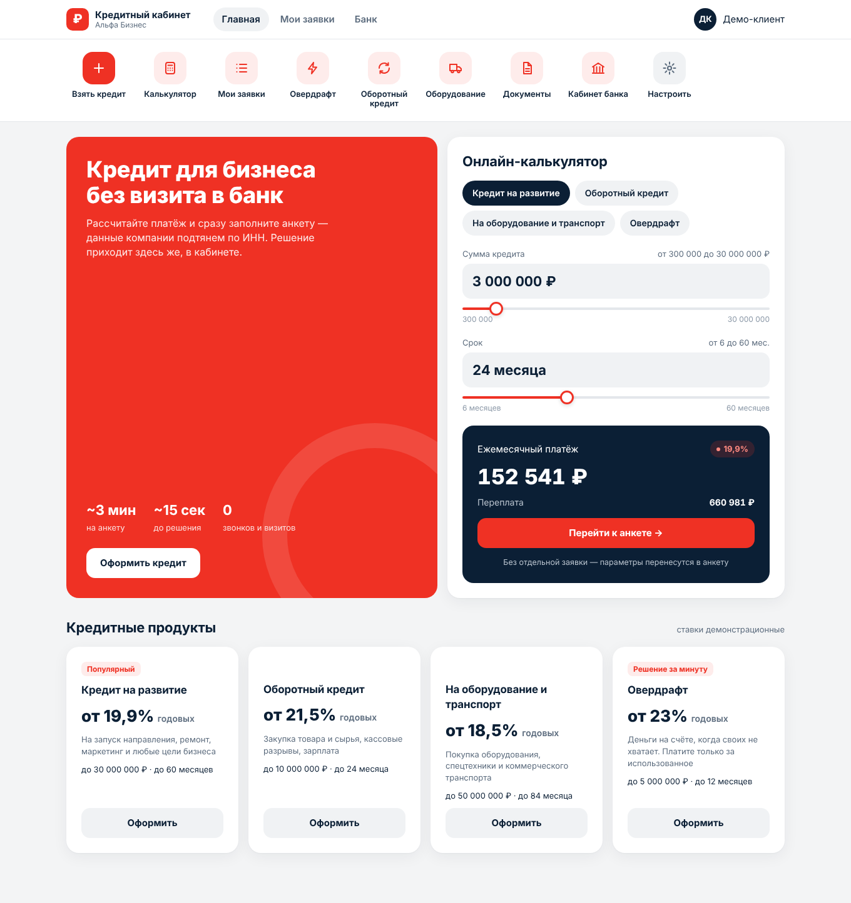
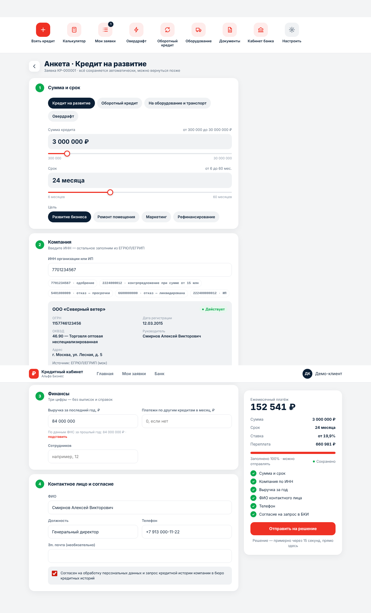
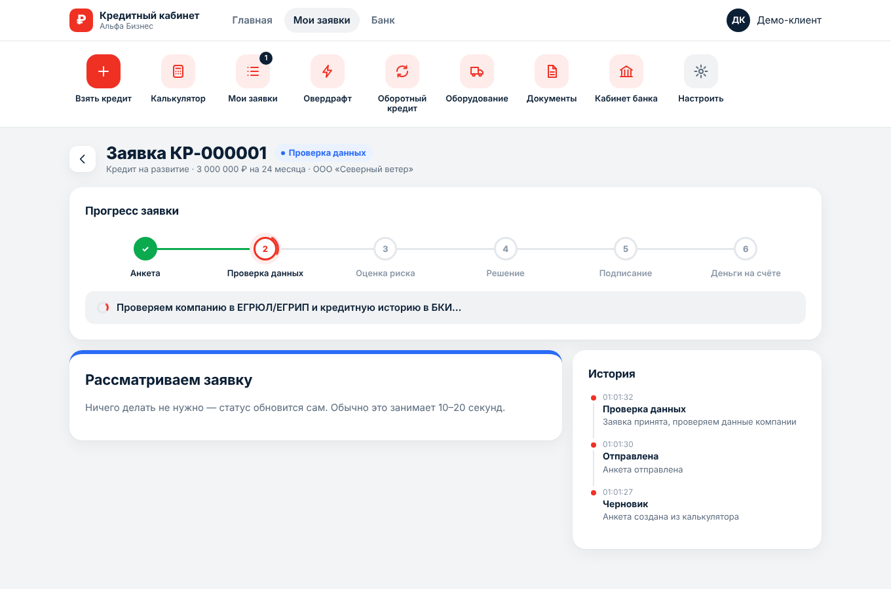
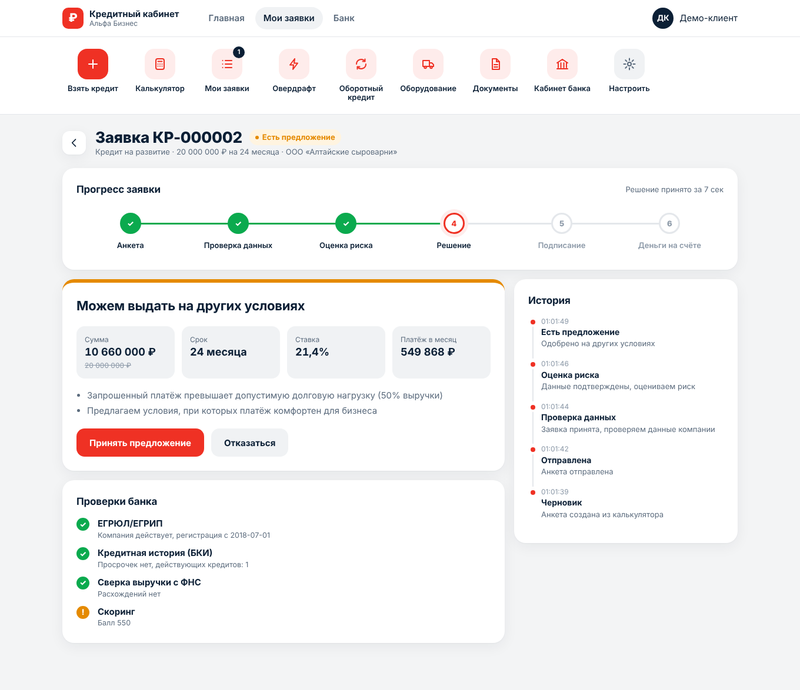
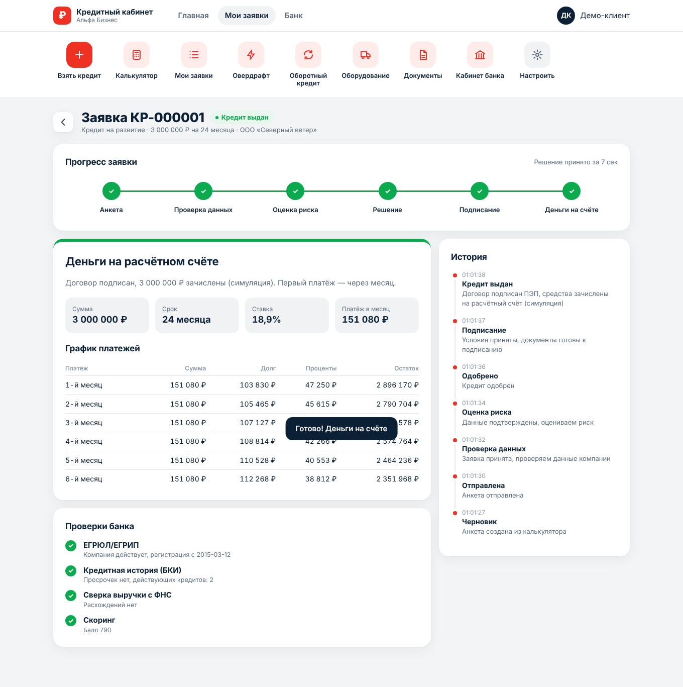
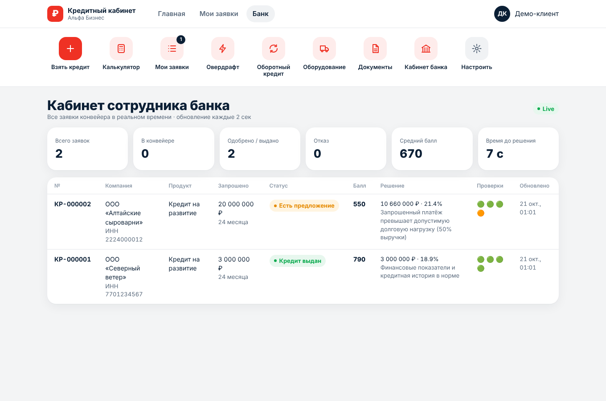

# Умный кредитный кабинет предпринимателя

Прототип цифрового кредитного конвейера для малого и микробизнеса (Альфа Хак, 2026).
Предприниматель проходит весь путь в одном веб-кабинете: калькулятор → анкета → проверки → решение → подписание → деньги. Банк видит тот же процесс в своём кабинете в реальном времени.

## Ключевые продуктовые решения

1. **Онлайн-калькулятор встроен в анкету.** Платёж пересчитывается на каждое движение ползунка, а параметры из калькулятора на главной переносятся в анкету без повторного ввода.
2. **Хот-бар как в банковских приложениях.** Быстрые действия всегда на виду: взять кредит, калькулятор, мои заявки со счётчиком активных, овердрафт и т.д. Набор кнопок клиент настраивает сам.
3. **Минимум затраченного времени.** В анкете 6 обязательных пунктов. Компанию подтягиваем по ИНН из ЕГРЮЛ/ЕГРИП, контактное лицо предзаполняем руководителем, выручку подставляем из данных ФНС одной кнопкой. Анкета сохраняется автоматически, рядом виден процент заполнения и сколько примерно осталось. Решение приходит за ~7–15 секунд.
4. **Без шага «оставить заявку».** Кнопка в калькуляторе или в хот-баре сразу создаёт черновик и открывает анкету.
5. **Прогресс заявки.** Шесть этапов (Анкета → Проверка данных → Оценка риска → Решение → Подписание → Деньги на счёте), живое обновление, описание текущего действия банка, результаты проверок и история статусов.

Решение не бинарное: **одобрение**, **контрпредложение** (сумма/срок подобраны под долговую нагрузку), **запрос уточнения** (выручка не сходится с ФНС) или **отказ** с объяснением причин.

## Архитектура

Модульный монолит на Go 1.24 (только stdlib) с фоновым конвейером. Фронтенд встроен в бинарь, поэтому всё работает в одном контейнере.
Подробно, с диаграммами компонентов, состояний заявки, ER-моделью и sequence-диаграммой: **[docs/ARCHITECTURE.md](docs/ARCHITECTURE.md)**.

```
backend/
  cmd/api/              точка входа, конфиг, graceful shutdown, -healthcheck
  internal/domain/      заявка, статусная машина, продукты, аннуитет
  internal/service/     сценарии клиента и банка
  internal/pipeline/    фоновый конвейер: data_check → scoring → решение
  internal/scoring/     балльная модель + кредитная логика (+ тесты)
  internal/integrations/моки ЕГРЮЛ/ЕГРИП/ФНС и БКИ
  internal/storage/     Repository; MVP — JSON-файл на volume с атомарной записью
  internal/httpapi/     REST API, middleware (+ e2e-тест)
  web/static/           SPA: index.html, app.css, app.js
docs/
  ARCHITECTURE.md  openapi.yaml  requests.http
```

## Запуск

Требования: Docker 24+ с Compose v2. Больше ничего не нужно.

```bash
cp .env.example .env      # необязательно
docker compose up -d --build
open http://localhost:8080
```

Без Docker (Go 1.24+): `make run`. Тесты: `make test`.

| Переменная | По умолчанию | Назначение |
|---|---|---|
| `HTTP_PORT` | `8080` | порт на хосте |
| `PIPELINE_STEP_DELAY` | `3s` | имитация времени обработки каждого этапа |
| `BANK_TOKEN` | `demo-bank` | токен кабинета банка (`X-Bank-Token`) |
| `DATA_FILE` | `/data/applications.json` | файл хранилища (volume `credit-data`) |

Healthcheck: `GET /healthz`, `GET /readyz`. Логи пишутся в stdout в JSON с `X-Request-ID`.

## Тестовые сценарии

Демо-ИНН есть прямо в анкете: их можно нажать как подсказки.

| ИНН | Что ввести | Ожидаемый результат |
|---|---|---|
| `7701234567` | 3 000 000 ₽ / 24 мес, выручка «подставить» | **Одобрено** (−1 п.п. к ставке) → принять → подписать → **Кредит выдан** |
| `2224000012` | 20 000 000 ₽ / 24 мес, выручка «подставить», обязательства 200 000 | **Контрпредложение** с меньшей суммой |
| `2224000012` | любая сумма, выручка 50 000 000 | **Нужны уточнения** (выручка > 1,5 × ФНС) → исправить → повторная отправка |
| `5401000009` | любые | **Отказ**: просрочки в БКИ, много кредитов |
| `6600000000` | любые | **Отказ** на проверке данных: компания ликвидирована |
| `222400000012` | ИП, зарегистрирован < 1 года | одобрение или контрпредложение в зависимости от суммы |
| любой другой 10/12-значный | — | компания генерируется детерминированно; `0000…` — «не найдена» |

Кабинет банка: вкладка «Банк» или `#/bank`. Там KPI, все заявки, баллы, решения и проверки.
Запросы к API: [docs/requests.http](docs/requests.http), контракт: [docs/openapi.yaml](docs/openapi.yaml).

## Допущения

- Аутентификация упрощена до `X-Client-ID`, его генерирует браузер. В проде это OIDC на API Gateway.
- Внешние источники (ЕГРЮЛ, ФНС, БКИ) работают как локальные моки, контракты сокращены.
- Подписание (ПЭП) и выдача денег симулируются внутри продукта, без SMS и почты.
- Ставки и лимиты продуктов демонстрационные.

## Экраны

| | |
|---|---|
|  |  |
|  |  |
|  |  |
