<div align="center">

# Умный кредитный кабинет предпринимателя

**Кредит для малого бизнеса онлайн: от расчёта платежа до денег на счёте — за несколько минут, в одном кабинете.**<br>
Клиент подаёт заявку, банковский конвейер проверяет данные и принимает решение, обе стороны видят процесс в реальном времени.

[](https://github.com/xdtqwd/alfa-credit/actions/workflows/ci.yml)


**Альфа Хак 2026 · кейс «Умный кредитный кабинет предпринимателя»**

[Быстрый старт](#-быстрый-старт) · [Проверка](#-как-проверить-что-всё-работает) · [Демо](#-демонстрация) · [Как это работает](#-как-это-работает) · [Платформа](#-платформа-postgresql--kafka) · [Скриншоты](#-скриншоты) · [Архитектура](docs/ARCHITECTURE.md) · [API](docs/openapi.yaml) · [Тесты](#-тестирование)

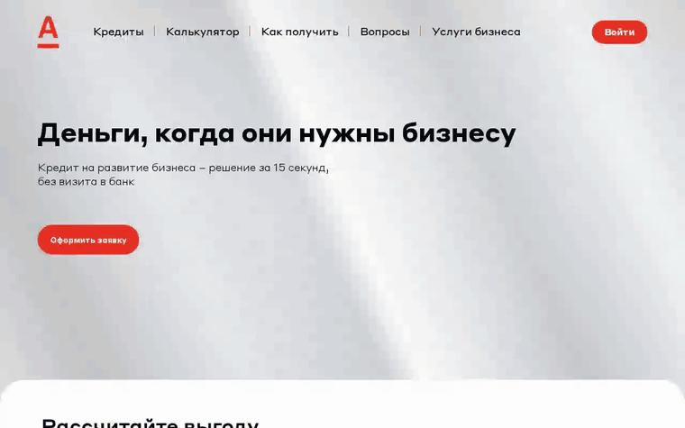

<sub>Полное видео с подписями (~75 с): <a href="demo/alfa-credit-demo.mp4">demo/alfa-credit-demo.mp4</a></sub>

</div>

---

## 🚀 Быстрый старт

Нужен только **Docker** (Desktop или Engine 24+ с Compose v2).

```bash
git clone https://github.com/xdtqwd/alfa-credit.git && cd alfa-credit
docker compose up -d --build        # API + worker + PostgreSQL + Kafka; первый запуск ~1–2 мин
```

Откройте **http://localhost:8080** и войдите демо-аккаунтом — в окне входа они выбираются одним кликом.
Kafka UI (топики и сообщения): `docker compose --profile tools up -d` → http://localhost:8081.

| Телефон | Пароль | Компания | Что покажет |
|---|---|---|---|
| `+7 900 000-00-01` | `demo1234` | ООО «Северный ветер» | ✅ одобрение → подписание → деньги → оплата |
| `+7 900 000-00-02` | `demo1234` | ООО «Алтайские сыроварни» | 🔄 контрпредложение (сумма от 15 млн) или уточнение (выручка 50 млн) |
| `+7 900 000-00-03` | `demo1234` | ООО «Сибирский кран» | ❌ отказ: просрочки в БКИ |
| `+7 900 000-00-04` | `demo1234` | ООО «Закрытый горизонт» | ❌ отказ: компания ликвидирована |
| Сотрудник банка | — | — | 🏦 все заявки конвейера вживую: ссылка «Кабинет банка» в подвале или `#/bank` |

Можно и зарегистрироваться с любым 10- или 12-значным ИНН — компания подтянется из реестра.

<details>
<summary><b>Без Docker, переменные окружения, Makefile</b></summary>

С Go 1.24+ без БД и Kafka: `make run` — тот же код на JSON-файлах и in-memory шине событий (для разработки и тестов).
Docker: `make up`, `make down`, `make logs`.

| Переменная | По умолчанию | Назначение |
|---|---|---|
| `DATABASE_URL` | — (в compose задан) | PostgreSQL; без него — файловый режим |
| `KAFKA_BROKERS` | — (в compose `kafka:9092`) | брокеры Kafka через запятую; без них — in-memory шина |
| `APP_ROLE` | `all` | `api` (HTTP + outbox relay) · `worker` (consumers + sweeper) · `all` |
| `HTTP_PORT` / `METRICS_PORT` | `8080` / `9090` | порты на хосте; `/metrics` открыт только на 127.0.0.1 |
| `PIPELINE_STEP_DELAY` | `3s` | имитация времени обработки каждого этапа конвейера |
| `RATE_LIMIT_RPS` / `RATE_LIMIT_BURST` | `20` / `60` | лимит запросов к API на IP |
| `REQUEST_TIMEOUT` | `10s` | предел времени запроса к API |
| `CACHE_REGISTRY_TTL` / `CACHE_BUREAU_TTL` | `1h` / `10m` | кэш ответов ЕГРЮЛ/ФНС и БКИ |
| `LOG_LEVEL` / `LOG_FORMAT` | `info` / `json` | логи (`text` — для отладки) |
| `APP_MODE` | `production` (в compose и `make run` — `demo`) | `production`: `BANK_TOKEN` обязателен (от 16 символов, не `demo-bank`), cookie сессии только по HTTPS; иначе сервис не стартует. `demo`: публичный токен и cookie без `Secure` для `http://localhost` |
| `BANK_TOKEN` | — (в демо `demo-bank`) | токен кабинета банка (`X-Bank-Token`) |
| `COOKIE_SECURE` | `true` в production, `false` в демо | флаг `Secure` у cookie сессии |
| `POSTGRES_PASSWORD` | `credit-local` | пароль БД в compose |

Health: `GET /healthz` (жив), `GET /readyz` (PostgreSQL и Kafka доступны, с причиной отказа). Метрики: `GET :9090/metrics`.
</details>

## ✅ Как проверить, что всё работает

После `docker compose up -d --build` одна команда проходит весь кредитный процесс через API и проверяет платформу:

```bash
bash scripts/check.sh         # ~10 с
bash scripts/check.sh --chaos # + остановка Kafka: заявки принимаются, после восстановления доходят до решения
```

<details>
<summary><b>Что проверяется и пример вывода</b></summary>

Внутри — программа `/selfcheck`, она уже лежит в образе (Go, Node и curl на машине не нужны). Её можно запустить и вручную: `docker compose exec api /selfcheck`.

```
Инфраструктура
  ✓ /readyz — готов: kafka=ok, storage=ok
  ✓ платформа: хранилище postgres, шина kafka, в outbox ждут 0
Клиент: от калькулятора до решения
  ✓ заявка создана: КР-000001 (сразу анкета, без «оставить заявку»)
  ✓ повтор с тем же Idempotency-Key вернул ту же заявку, дубль не создан
  ✓ заявка подана за 4 мс — ответ не ждёт конвейер
  ✓ решение конвейера через 3.5 с: approved, балл 790
  ✓ опрос статуса: пока ничего не изменилось, сервер отвечает 304 без тела (ETag)
  ✓ решение принял отдельный воркер по событию из Kafka (outbox → топик → consumer group)
Подписание, выдача, оплата
  ✓ на счёт зачислено ровно 3000000 ₽
  ✓ платёж 151080 ₽ списан один раз, хотя запрос отправлен дважды (как при обрыве сети)
Сторона банка
  ✓ журнал аудита: application.create, application.submit, application.accept, loan.sign_and_disburse, loan.pay
Поведение API
  ✓ неизвестный путь → JSON 404 с request_id
  ✓ метрики размечены шаблоном маршрута
Итог: пройдено 29, ошибок 0
```

С `--chaos`: при остановленной Kafka заявка принимается, `/readyz` отвечает `200 degraded` (балансировщик не снимает API), события ждут в outbox; после `docker compose start kafka` заявка доходит до решения — событие не теряется.

Посмотреть руками:

| Что | Где |
|---|---|
| Сообщения в Kafka | `docker compose --profile tools up -d` → http://localhost:8081 (Kafka UI): топики `credit.applications.v1` и `…dlq.v1` |
| Таблицы PostgreSQL | `docker compose exec postgres psql -U credit -c "select number, status from applications"` |
| Outbox и аудит | `… -c "select count(*) filter (where published_at is null) from outbox"`, `… -c "select action, actor, at from audit_log order by id desc limit 10"` |
| Логи с корреляцией | `docker compose logs -f api worker` — у HTTP-запроса и шагов конвейера общий `rid` |
| Метрики | http://localhost:9090/metrics |
| Состояние платформы | «Кабинет сотрудника банка» → строка с хранилищем, шиной, outbox и кэшем |
</details>

Каждый pull request прогоняет то же самое в [CI](.github/workflows/ci.yml): тесты на настоящих PostgreSQL и Kafka, весь стек в docker compose, 26 браузерных e2e, самопроверку и отказ Kafka. Как вести ветки — в [CONTRIBUTING.md](CONTRIBUTING.md).

## 🔁 Как это работает

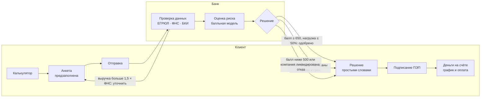

Решение не бинарное: **одобрение**, **контрпредложение**, **запрос уточнения** или **отказ** — всегда с причинами на цифрах из анкеты и советом, что сделать. В каждом решении есть блок **«Как банк оценил заявку»**: шкала балла с зонами (отказ · другие условия · одобрение), отметка вашего балла и факторы с плюсами и минусами. Сотрудник банка видит ту же заявку в своём кабинете: статус, балл, проверки и решение.

<details>
<summary><b>Какие данные дают какой исход</b></summary>

| Исход | Сценарий | Аккаунт | Данные |
|---|---|---|---|
| ✅ Одобрение (ставка −1 п.п.) | здоровый бизнес, небольшая нагрузка | `…01` «Северный ветер» | 3 млн ₽ на 24 мес., выручка 84 млн ₽ |
| ✅ Одобрение | крупный кредит на оборудование | `…01` «Северный ветер» | 15 млн ₽ на 60 мес. |
| ✅ Одобрение | тот же клиент, что ниже, но разумная сумма | `…02` «Алтайские сыроварни» | 3 млн ₽, выручка 18 млн ₽ |
| 🔄 Другие условия | нагрузка больше 50% выручки — банк уменьшает сумму | `…02` | 20 млн ₽, текущие платежи 200 тыс. ₽/мес |
| ✍️ Уточнение | выручка в анкете больше данных ФНС в 1,5+ раза | `…02` | выручка 50 млн ₽ |
| ❌ Отказ | просрочки до 45 дней, 4 кредита — балл ниже 500 | `…03` «Сибирский кран» | 3 млн ₽ |
| ❌ Отказ | компания ликвидирована по ЕГРЮЛ | `…04` «Закрытый горизонт» | любая сумма |

Каждая строка — эталонный кейс в тесте `TestScenariosProduceExpectedOutcome`: он прогоняет данные через настоящий конвейер и скоринг, поэтому таблица не может разойтись с поведением.
</details>

## 🧱 Платформа: PostgreSQL + Kafka

Кредитный процесс меняет деньги и юридически значимые статусы, поэтому платформа устроена как в банке:

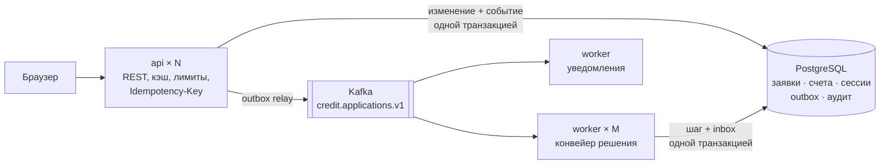

| | Зачем |
|---|---|
| **PostgreSQL** | ACID-транзакции для денег: выдача (статус + зачисление на счёт) и платёж (списание + запись) атомарны; `SELECT … FOR UPDATE`; `CHECK (balance >= 0)`; неизменяемый журнал аудита (триггер запрещает UPDATE/DELETE); сессии и ключи идемпотентности в БД, поэтому API масштабируется горизонтально; миграции при старте под advisory lock. |
| **Kafka + transactional outbox** | Событие пишется в ту же транзакцию, что и смена статуса, а relay доставляет его в Kafka: событие не теряется, даже если брокер лежит (API при этом продолжает принимать заявки). Конвейер решения и уведомления — независимые consumer groups. Ключ — id заявки (порядок внутри заявки), 6 партиций (параллелизм), at-least-once + inbox (без дублей), DLQ для «ядовитых» сообщений, `request_id` в заголовках для сквозной трассировки. |
| **Кэш** | ЕГРЮЛ/ФНС (1 ч, «не найдено» — 5 мин), БКИ (10 мин), калькулятор, сессии; singleflight защищает внешние сервисы от шторма запросов; `ETag`/`304` для опроса статуса. |
| **Наблюдаемость** | JSON-логи с `request_id`, маскирование ПДн, метрики Prometheus (HTTP, события, outbox, решения, кэши), `/readyz` с причиной отказа, состояние платформы в кабинете банка. |
| **Надёжность API** | `Idempotency-Key` (повтор не задвоит платёж — фронт сам ставит ключ и повторяет при обрыве сети), лимит запросов `429 + Retry-After`, таймауты, JSON-ошибки с `request_id`, пагинация `X-Total-Count`/`Link`, gzip. |

Проверено: Kafka «заморожена» → подача заявки отвечает 200 за 7 мс, события копятся в outbox → брокер вернулся → заявка одобрена через 3 с. Два воркера делят партиции: 12/12 заявок решены, дублей нет. Подробно, с отказами и гарантиями: **[docs/ARCHITECTURE.md](docs/ARCHITECTURE.md)**.

## ✨ Что внутри

| | |
|---|---|
| 🧮 **Калькулятор прямо в анкете** | Платёж пересчитывается на каждое движение ползунка, параметры с главной переносятся в анкету. Считает только сервер (Go) — один источник расчёта для фронта и бэка. |
| ⚡ **Минимум времени** | Без шага «оставить заявку»: кнопка сразу открывает анкету. Компания — из ЕГРЮЛ по ИНН, контакт — из профиля, выручка — из ФНС одной кнопкой. 6 обязательных пунктов, решение за ~7–15 секунд. |
| 📍 **Прогресс заявки** | Шесть этапов (Анкета → Проверка данных → Оценка риска → Решение → Подписание → Деньги), живое обновление, история статусов и результаты проверок. |
| 💬 **Понятные шаги** | У каждого статуса крупно: нужно ли что-то от вас и что именно, с кнопкой действия. При других условиях — таблица «Вы просили / Банк предлагает / Разница» по сумме, сроку, ставке, платежу и переплате. |
| 💾 **Честное автосохранение** | «Сохраняем… / Сохранено / Не сохранено · Повторить». Без сети поля не теряются и досохраняются сами. |
| 🏠 **Минималистичный кабинет** | Заявки · Кредиты · Сообщения, баланс счёта, реквизиты, оплата платежа со своего счёта, уведомления о решениях банка. |
| 🎨 **Брендбук Альфа-Банка** | Палитра брендбука (красный #EF3124, графитовый Pantone 445, Cool Grey 1) в спокойных пропорциях, элемент «фундамент» под заголовками, знак «А», иконки [Core Components](https://github.com/core-ds/core-components), шрифт Inter вместо Styrene. Вход ведёт сразу в «Профиль и реквизиты»; у каждого действия одно место на экране. Адаптив до телефона. |
| 🔒 **Безопасность** | Без входа нельзя оформить, подписать и оплатить. HttpOnly-cookie `SameSite=Strict`, проверка Origin (CSRF), PBKDF2-хэши паролей, блокировка перебора, лимиты запросов. |

## 🎬 Демонстрация

- **Видео:** [demo/alfa-credit-demo.mp4](demo/alfa-credit-demo.mp4) — весь связанный процесс одним дублем: калькулятор → вход → анкета → заявка идёт по конвейеру в кабинете банка (отправлена → проверка данных → оценка риска → одобрено, балл 790) → решение у клиента → подписание → деньги → оплата → отказ другому клиенту с объяснением.
- **Вживую:** `docker compose up -d --build` и демо-аккаунты выше — роли клиента и сотрудника банка уже готовы.

Видео и скриншоты записываются автоматически с работающего приложения, их легко обновить (Node не нужен):

```bash
docker run --rm --network host -v "$PWD":/w -w /w mcr.microsoft.com/playwright:v1.56.0-noble \
  sh -c "cd tests/e2e && npm ci >/dev/null && BASE_URL=http://localhost:8080 node demo.mjs"
# скриншоты: тот же запуск с tests/e2e/screens.mjs (на чистых данных)
```

На macOS/Windows замените `localhost` на `host.docker.internal` и уберите `--network host`.

## 📸 Скриншоты

| Главная | Анкета с калькулятором |
|:---:|:---:|
| 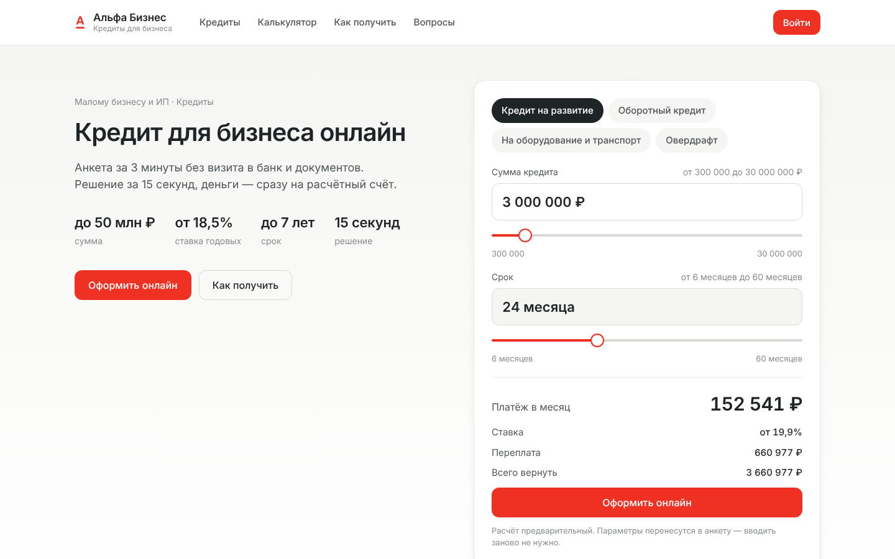 | 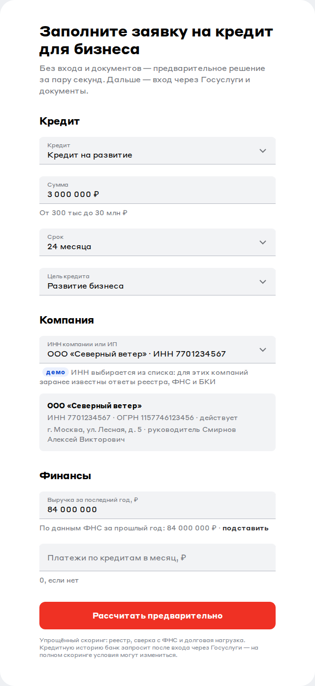 |
| **Прогресс заявки** | **Кабинет сотрудника банка** |
| 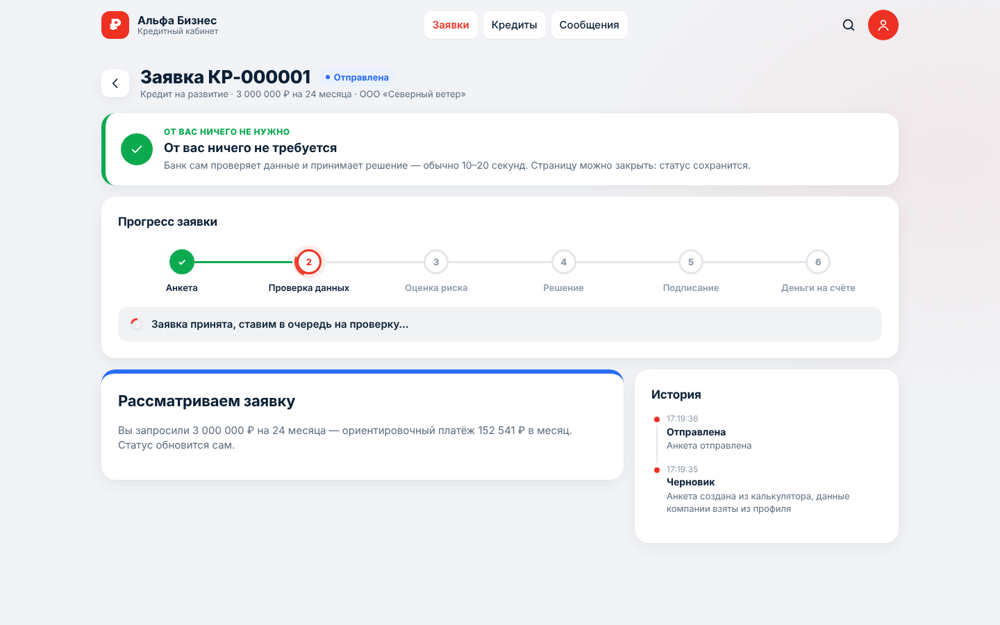 | 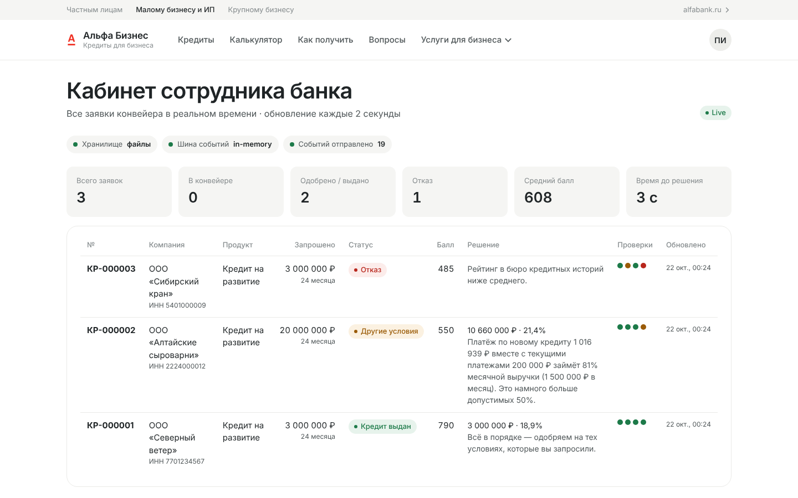 |
| **Одобрено: сравнение условий** | **Контрпредложение** |
| 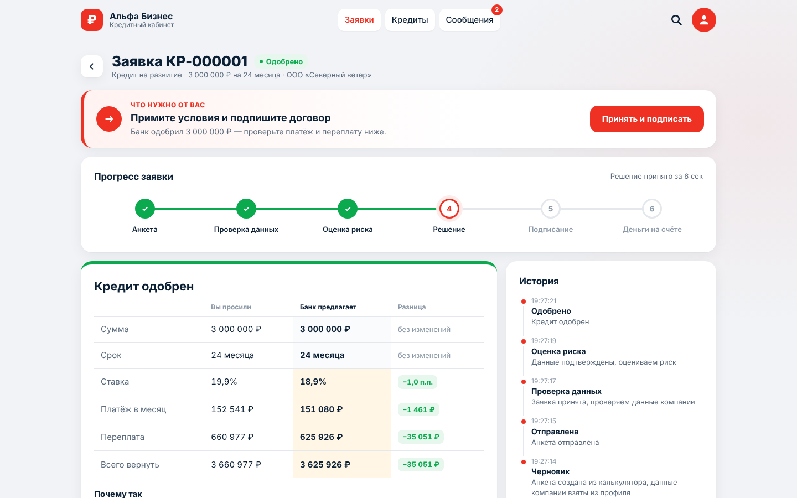 | 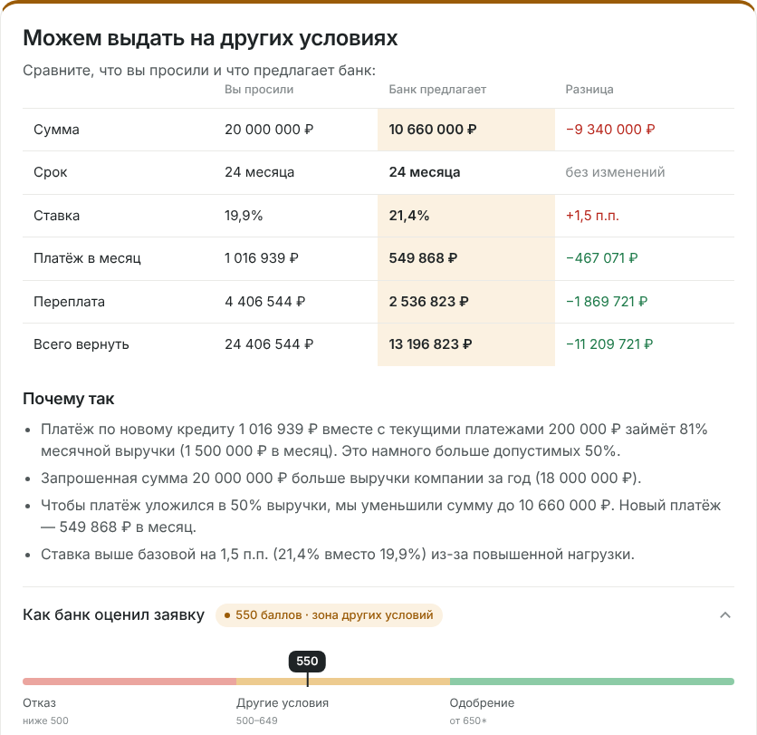 |
| **Отказ с объяснением** | **Кабинет: кредиты** |
| 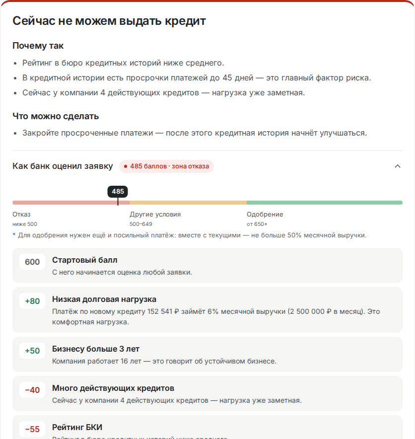 | 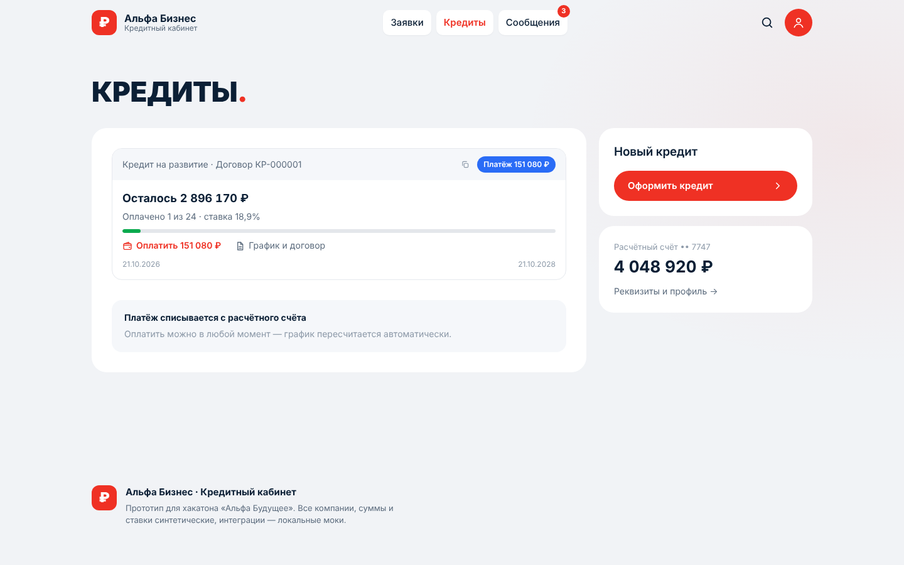 |
| **Как банк оценил заявку** | **Кабинет банка: состояние платформы** |
| 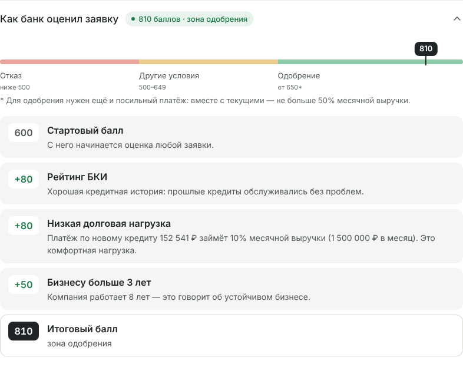 | 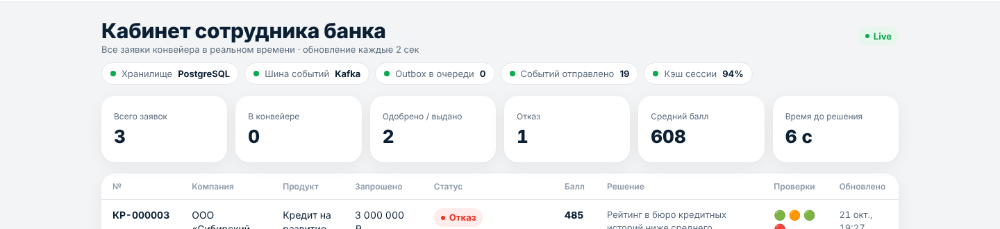 |
| **Профиль и реквизиты** | **Меню профиля** |
| 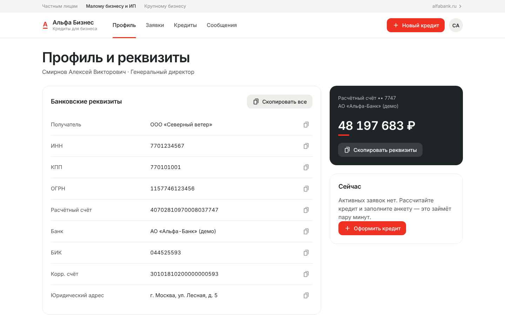 | 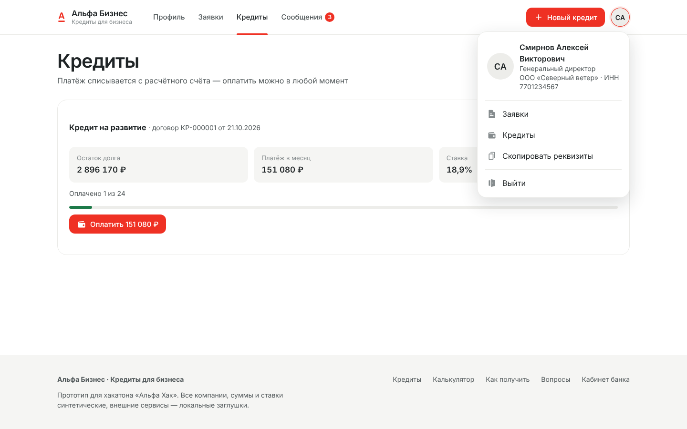 |

<p align="center">
  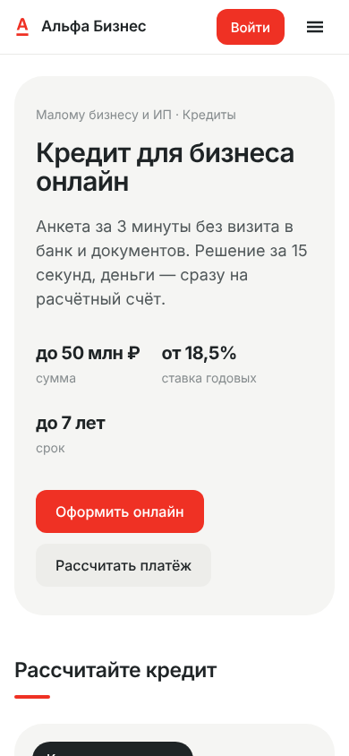
  &nbsp;&nbsp;
  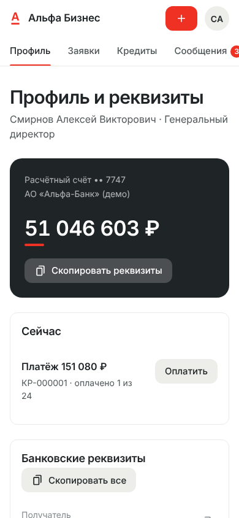
</p>

## ✅ Соответствие условиям кейса

| Требование | Как выполнено |
|---|---|
| Связанный процесс клиент ↔ банк | Клиент подаёт заявку и получает результат; фоновый конвейер (`internal/pipeline`) проверяет данные через ЕГРЮЛ/ФНС/БКИ (`internal/integrations`), считает балл и принимает решение (`internal/scoring`). Банк видит то же в «Кабинете сотрудника банка». Кредитная логика упрощённая: балльная модель + долговая нагрузка. |
| Enterprise-ориентированность | **Безопасность:** обязательный вход, HttpOnly-cookie, CSRF, PBKDF2, хэш токена в БД, CSP, distroless nonroot, read-only FS, маскирование ПДн, неизменяемый аудит. **Надёжность:** ACID-транзакции для денег, transactional outbox, идемпотентные потребители, `Idempotency-Key`. **Отказоустойчивость:** API работает при недоступной Kafka, повторы + DLQ, sweeper, `/readyz`, таймауты, graceful shutdown. **Масштабирование:** stateless API, воркеры по партициям Kafka (`--scale worker=N`), кэш. **Сопровождение:** JSON-логи с `request_id`, метрики Prometheus, миграции, OpenAPI, тесты на реальных PostgreSQL и Kafka-протоколе. |
| Целостность решения | Один связанный процесс от обращения за продуктом до результата: калькулятор → анкета → проверки → решение → подписание → деньги → платежи; каждый шаг виден клиенту и банку, каждое изменение — событие в Kafka и запись в аудите. |
| Контракты внешних сервисов | ЕГРЮЛ/ФНС и БКИ — адаптеры за интерфейсами `Registry` и `CreditBureau` с упрощёнными контрактами, но с той же целью (данные компании, выручка, кредитная история); кэш, метрики времени ответа; замена мока на реальный клиент не трогает бизнес-логику. |
| Без платных API и подписок | Внешних платных вызовов нет: ЕГРЮЛ, ФНС, БКИ — локальные моки, подписание и выдача симулируются. PostgreSQL и Kafka — бесплатное ПО с открытым кодом в том же `docker compose`. Работает офлайн. |
| Обычный ПК | ~1 ГБ RAM на всё (из них Kafka — 512 МБ). ML-модель и GPU не используются — решение принимает детерминированная балльная модель. |
| Демонстрация | Предзаполненные аккаунты с ролями клиента и банка + [видео](demo/alfa-credit-demo.mp4). |
| Репозиторий | Docker, `go.mod`/`go.sum`, README, [THIRD_PARTY_NOTICES](THIRD_PARTY_NOTICES), [OpenAPI](docs/openapi.yaml), [архитектура](docs/ARCHITECTURE.md), тесты. |

<details>
<summary><b>Требования к ресурсам</b></summary>

| | Минимум | Факт |
|---|---|---|
| ОС | Windows 10+, macOS 12+, Linux | — |
| Docker | Desktop / Engine 24+ с Compose v2 | — |
| CPU | 2 ядра | лимиты: api и worker по 0,5, PostgreSQL 0,5, Kafka 1 |
| Память | 2 ГБ свободной RAM | Kafka до 512 МБ, PostgreSQL до 256 МБ, api и worker по ~20 МБ (лимит 128 МБ) |
| Диск | ~2 ГБ (образы: Kafka ~400 МБ, PostgreSQL ~250 МБ, сборка Go ~600 МБ) | итоговый образ сервиса ~12 МБ (distroless) |
| Сеть | только для первой сборки (образы и Go-модули) | в работе интернет не нужен |
| GPU / ML-модель | не нужны | скоринг — правила и баллы |
</details>

## 🏗 Архитектура

Модульный монолит на **Go 1.24** (stdlib + драйверы `lib/pq` и `franz-go`) с двумя ролями из одного образа: **api** и **worker**. Фронтенд (vanilla JS SPA) встроен в бинарь, контейнер — distroless без root. Диаграммы компонентов, статусов заявки, ER-модель и sequence — в **[docs/ARCHITECTURE.md](docs/ARCHITECTURE.md)**. Контракт API: [docs/openapi.yaml](docs/openapi.yaml), примеры запросов: [docs/requests.http](docs/requests.http).

```
backend/
  cmd/api/               точка входа, конфиг, graceful shutdown, -healthcheck
  internal/domain/       заявка, статусная машина, продукты, расчёт платежа и графика
  internal/service/      сценарии клиента и банка: транзакции, аудит, пагинация
  internal/pipeline/     конвейер решения: consumer Kafka + sweeper (идемпотентный)
  internal/scoring/      балльная модель и кредитная логика
  internal/notify/       уведомления клиента (отдельная consumer group)
  internal/events/       события, in-memory шина; kafkabus/ — Kafka (franz-go): продюсер, consumer groups, DLQ
  internal/storage/      порты хранения + файловый режим; pgstore/ — PostgreSQL: миграции, outbox, inbox, сессии, аудит
  internal/cache/        TTL-LRU кэш с singleflight
  internal/idempotency/  ключи Idempotency-Key (PostgreSQL / память)
  internal/integrations/ моки ЕГРЮЛ/ЕГРИП/ФНС и БКИ + кэширующие адаптеры
  internal/obs/          логи с request_id, маскирование ПДн, метрики Prometheus, аудит
  internal/auth/         пароли (PBKDF2), сессии, защита от перебора
  internal/httpapi/      REST /api/v1, middleware (лимиты, ETag, gzip, идемпотентность), /metrics
  web/static/            SPA без сборки: index.html, css/ (токены брендбука, база, компоненты, страницы),
                         js/core (api, сессия, роутер), js/pages (экраны), js/features, js/ui, fonts/
tests/e2e/               браузерные тесты, запись демо-видео, скриншоты
```

## 🧪 Тестирование

```bash
bash scripts/test-all.sh     # vet → тесты с race-детектором и покрытием → гонки ×20 → e2e в браузере
cd backend && go test ./...  # только Go, без внешних зависимостей
make test-integration        # + интеграционные тесты на PostgreSQL и Kafka из docker compose (Go ставить не нужно)
cd tests/lint && npm ci && npm run lint   # фронтенд: ESLint, Prettier, CSS-переменные, юнит-тесты
```

<details>
<summary><b>Что проверяется</b></summary>

| Уровень | Что проверяется | Где |
|---|---|---|
| Домен | все переходы статусов, валидация анкеты, свойства графика (долг гасится в ноль, сумма графика = итог расчёта) на сотнях комбинаций | `internal/domain` |
| Скоринг | одобрение, контрпредложение, отказ; объяснение опирается на цифры анкеты | `internal/scoring` |
| Конвейер | 5 сценариев решений через моки ЕГРЮЛ/БКИ; отменённая заявка не «оживает» | `internal/pipeline` |
| Сервис | префилл, ограничения продукта, чужие заявки невидимы, выдача, оплата до закрытия; каждый сценарий проверки даёт обещанный исход | `internal/service` |
| Хранилище | перезапуск, атомарная запись, откат при ошибке, параллельные обновления | `internal/storage` |
| PostgreSQL (интеграционные) | миграции идемпотентны; событие пишется в outbox в той же транзакции, откат не оставляет события; relay при недоступном брокере ничего не теряет; 8 параллельных оплат — ровно 3 платежа и совпадение сумм; нехватка денег откатывает платёж; `CHECK (balance >= 0)`; аудит нельзя изменить или удалить; в БД только хэш токена, сессию видит другой экземпляр; Idempotency-Key и inbox | `internal/storage/pgstore` |
| Kafka (интеграционные) | порядок событий внутри ключа и fan-out на две consumer group; «ядовитое» сообщение после 3 попыток уходит в DLQ | `internal/events/kafkabus` |
| Платформа API | Idempotency-Key: повтор оплаты не списывает второй раз, ключ с другим запросом → 422, ключи изолированы по клиентам; ETag/304; пагинация и фильтры (422 на неверные параметры); лимит 429 + Retry-After; JSON 404/405 с request_id; gzip и ETag статики; `/readyz` с причиной | `internal/httpapi` |
| События и кэш | порядок по ключу, fan-out, повторы → DLQ; событийный конвейер доводит заявку до решения без опроса; повторная доставка безвредна; TTL, LRU, singleflight (один вызов на 50 запросов), кэш «не найдено» | `internal/events`, `internal/pipeline`, `internal/cache` |
| Безопасность API | 401 без входа, 404 на чужие заявки, CSRF → 403, флаги cookie, лимит тела, перебор → 429, токен банка, заголовки | `internal/httpapi` |
| Гонки | параллельные оплаты и подписания: деньги списываются и зачисляются ровно один раз | `internal/httpapi` |
| E2E (браузер) | 26 сценариев: гость, вход по требованию, расчёт с сервера, срок числом или ползунком, вход в профиль с реквизитами, вкладки кабинета, полный путь до оплаты, контрпредложение, уточнение, отказ, автосохранение без сети, шапка без наложений, логотип, меню профиля (в т.ч. на телефоне касанием), разделы сайта на телефоне, «Услуги для бизнеса» со ссылками на alfabank.ru, работа с клавиатуры, овердрафт с фиксированным сроком, разбор балла с положительным и отрицательным исходом, аккордеон, узкие экраны, Idempotency-Key у денежных действий, состояние платформы в кабинете банка, чужая заявка, старые адреса + регрессии. Прогоняются в трёх режимах: файлы, PostgreSQL, PostgreSQL + Kafka (раздельные api и worker) | `tests/e2e/e2e.mjs` |

E2E без Node — в образе Playwright (сервер запущен на 8080, лучше с `PIPELINE_STEP_DELAY=1s`):

```bash
docker run --rm --network host -v "$PWD":/w -w /w mcr.microsoft.com/playwright:v1.56.0-noble \
  sh -c "cd tests/e2e && npm ci >/dev/null && BASE_URL=http://localhost:8080 node e2e.mjs"
```

Покрытие Go-кода — 83% (с интеграционными тестами; без них — около 70%).
</details>

## 📌 Допущения MVP

- Вход по телефону и паролю без SMS (по условиям кейса сценарий не уходит в SMS). В проде — OIDC (Альфа ID) на API Gateway.
- Один брокер Kafka и один экземпляр PostgreSQL (под обычный ПК). В проде — 3 брокера с `min.insync.replicas=2` и PostgreSQL с репликацией (Patroni); кэш и лимиты запросов — общие, в Redis.
- ЕГРЮЛ, ФНС, БКИ — локальные моки с сокращёнными контрактами; подписание (ПЭП) и выдача денег симулируются.
- Ставки, лимиты и компании демонстрационные, все данные синтетические.
