# Умный кредитный кабинет предпринимателя

Прототип цифрового кредитного конвейера для малого и микробизнеса (Альфа Хак, 2026).
Предприниматель проходит весь путь в одном веб-кабинете: калькулятор → анкета → проверки → решение → подписание → деньги. Банк видит тот же процесс в своём кабинете в реальном времени.

## Ключевые продуктовые решения

1. **Онлайн-калькулятор встроен в анкету.** Платёж пересчитывается на каждое движение ползунка, а параметры из калькулятора на главной переносятся в анкету без повторного ввода.
2. **Стиль сайта Альфа-Банка.** Белая шапка с разделами «Кредиты · Овердрафт · Калькулятор · Как получить · Вопросы» и кнопкой «Войти». Главная устроена как продуктовая страница: первый экран с фактами, выбор кредита, калькулятор, «Почему это удобно», «Как получить», требования и документы, частые вопросы, футер. После входа — минималистичный кабинет: в шапке три раздела «Заявки · Кредиты · Сообщения» (со счётчиком непрочитанного) и аватар. На каждой странице — крупный заголовок, одна карточка со списком (фильтры «Все · Нужно действие · В работе · Завершены»; в каждой заявке — продукт и номер, статус, сумма и срок, что от вас нужно, ссылки и даты) и одна карточка с главным действием («Оформить кредит», «Обращение в поддержку») плюс баланс счёта. Изменения по заявкам приходят карточками справа внизу.
3. **Минимум затраченного времени.** В анкете 6 обязательных пунктов. Компанию подтягиваем по ИНН из ЕГРЮЛ/ЕГРИП, контактное лицо предзаполняем руководителем, выручку подставляем из данных ФНС одной кнопкой. Анкета сохраняется автоматически, рядом виден процент заполнения и сколько примерно осталось. Решение приходит за ~7–15 секунд.
4. **Без шага «оставить заявку».** Кнопка в калькуляторе, у продукта или в быстрых действиях кабинета сразу создаёт черновик и открывает анкету.
5. **Прогресс заявки.** Шесть этапов (Анкета → Проверка данных → Оценка риска → Решение → Подписание → Деньги на счёте), живое обновление, описание текущего действия банка, результаты проверок и история статусов.

6. **Без входа ничего не оформить и не оплатить.** Смотреть продукты и калькулятор можно гостем, а оформление, подписание, оплата и реквизиты требуют входа. После входа действие продолжается с того места, где клиент остановился. Сессия хранится в HttpOnly-cookie (SameSite=Strict), запросы с чужого Origin отклоняются, пароли хранятся в виде PBKDF2-хэшей, после 5 ошибок вход блокируется на минуту. Регистрация идёт по ИНН: компания и реквизиты подтягиваются автоматически.
7. **Личный кабинет.** Баланс расчётного счёта, реквизиты с копированием по одному или всех сразу, данные компании из ЕГРЮЛ, выданные кредиты с прогрессом погашения и оплатой платежа со своего счёта.
8. **Шапка для гостя как у Сбера.** «Пилюля»: логотип, кнопка «≡ Меню», строка поиска и красная кнопка «Личный кабинет ▾». «Меню» открывает полноэкранную панель с колонками «Кредиты», «Подобрать по задаче», «Мой бизнес», «Поддержка и сервисы» и «Сейчас» (баланс и текущая заявка с тем, что от вас нужно). Ещё есть поиск по продуктам, заявкам, реквизитам и действиям (`Ctrl K` или `/`), уведомления о решениях банка и меню профиля. 

9. **Понятные шаги.** У каждого статуса заявки сверху крупно написано, нужно ли что-то от предпринимателя и что именно, с кнопкой нужного действия. При контрпредложении показывается таблица «Вы просили / Банк предлагает / Разница» по сумме, сроку, ставке, платежу, переплате и итоговой сумме к возврату. Причины решения написаны простыми словами на цифрах из анкеты, например «платёж 1 016 939 ₽ вместе с текущими 200 000 ₽ займёт 81% месячной выручки 1 500 000 ₽». При отказе и уточнении есть блок «Что можно сделать».
10. **Честное автосохранение.** Индикатор показывает «Сохраняем…», «Сохранено» или «Не сохранено: причина · Повторить». Несохранённые поля не теряются и отправляются повторно сами. Отправить анкету с несохранёнными правками нельзя.
11. **Один источник расчёта.** Платёж, переплату и график считает только Go (`domain.Quote`, `domain.Schedule`). Фронтенд берёт цифры из API (`/calc`, поля `quote`, `schedule`, `next_payment` у заявки) и формулу не дублирует. Поэтому при смене ставок или правил округления фронт и бэк не разойдутся. Тест проверяет, что сумма графика равна итогу расчёта, а последний платёж закрывает долг в ноль.

Решение не бинарное: **одобрение**, **контрпредложение** (сумма/срок подобраны под долговую нагрузку), **запрос уточнения** (выручка не сходится с ФНС) или **отказ** с объяснением причин.

## Архитектура

Модульный монолит на Go 1.24 (только stdlib) с фоновым конвейером. Фронтенд встроен в бинарь, поэтому всё работает в одном контейнере.
Подробно, с диаграммами компонентов, состояний заявки, ER-моделью и sequence-диаграммой: **[docs/ARCHITECTURE.md](docs/ARCHITECTURE.md)**.

```
backend/
  cmd/api/              точка входа, конфиг, graceful shutdown, -healthcheck
  internal/domain/      заявка, статусная машина, продукты, аннуитет
  internal/service/     сценарии клиента и банка
  internal/pipeline/    фоновый конвейер: data_check → scoring → решение
  internal/scoring/     балльная модель + кредитная логика (+ тесты)
  internal/integrations/моки ЕГРЮЛ/ЕГРИП/ФНС и БКИ
  internal/storage/     Repository; MVP — JSON-файл на volume с атомарной записью
  internal/httpapi/     REST API, middleware (+ e2e-тест)
  internal/auth/        хэширование паролей, сессии, защита от перебора
  web/static/           SPA: index.html, app.css, app.js, nav.js (меню, поиск), cabinet.js (главная кабинета, вкладки, уведомления)
docs/
  ARCHITECTURE.md  openapi.yaml  requests.http
```

## Запуск

Требования: Docker 24+ с Compose v2. Больше ничего не нужно.

```bash
cp .env.example .env      # необязательно
docker compose up -d --build
open http://localhost:8080
```

Без Docker (Go 1.24+): `make run`. Тесты: `make test`.

| Переменная | По умолчанию | Назначение |
|---|---|---|
| `HTTP_PORT` | `8080` | порт на хосте |
| `PIPELINE_STEP_DELAY` | `3s` | имитация времени обработки каждого этапа |
| `BANK_TOKEN` | `demo-bank` | токен кабинета банка (`X-Bank-Token`) |
| `DATA_FILE` | `/data/applications.json` | заявки (volume `credit-data`) |
| `USERS_FILE` | `/data/users.json` | пользователи (хэши паролей, баланс) |

Healthcheck: `GET /healthz`, `GET /readyz`. Логи пишутся в stdout в JSON с `X-Request-ID`.

## Тестовые аккаунты

Пароль у всех: `demo1234`. В окне входа аккаунты можно выбрать одним кликом.

| Телефон (логин) | Компания | Что покажет |
|---|---|---|
| `+7 900 000-00-01` | ООО «Северный ветер» | одобрение → подписание → выдача → оплата платежа |
| `+7 900 000-00-02` | ООО «Алтайские сыроварни» | контрпредложение при сумме от 15 млн, уточнение при завышенной выручке |
| `+7 900 000-00-03` | ООО «Сибирский кран» | отказ: просрочки в БКИ |
| `+7 900 000-00-04` | ООО «Закрытый горизонт» | отказ: компания ликвидирована |

Можно и зарегистрироваться с любым 10- или 12-значным ИНН, компания подтянется из мок-реестра.

## Тестовые сценарии

Компания в анкете берётся из профиля, поэтому сценарий выбирается аккаунтом.

1. **Гость.** Откройте главную, нажмите «Оформить» у любого продукта. Откроется окно входа, а после входа сразу анкета. Если войти через «Войти в кабинет», откроется главная кабинета.
2. **Одобрение** (`…01`). Выручку подставьте кнопкой «подставить», поставьте согласие и отправьте. Через ~5 секунд придёт «Одобрено». Дальше «Принять и подписать», и баланс вырастет на сумму кредита. Затем оплатите платёж на главной кабинета («Оплатить кредит») или в разделе «Счёт и реквизиты».
3. **Контрпредложение** (`…02`). Сумма 20 000 000 ₽, обязательства 200 000 ₽/мес. Банк предложит меньшую сумму.
4. **Уточнение** (`…02`). Выручка 50 000 000 ₽ (больше 1,5 × данных ФНС). Банк попросит исправить анкету, после правки отправьте снова.
5. **Отказ** (`…03` или `…04`). Причины показываются в карточке решения.
6. **Защита.** Выйдите и попробуйте `POST /api/v1/applications` без cookie: будет 401.

Кабинет банка: вкладка «Банк» или `#/bank`. Там KPI, все заявки, баллы, решения и проверки.
Запросы к API: [docs/requests.http](docs/requests.http), контракт: [docs/openapi.yaml](docs/openapi.yaml).

## Тестирование

```bash
./scripts/test-all.sh        # vet, тесты с race-детектором и покрытием, гонки ×20, e2e в браузере
cd backend && go test ./...  # только Go-тесты
```

| Уровень | Что проверяется | Где |
|---|---|---|
| Домен | все переходы статусов (разрешённые и запрещённые), валидация анкеты по каждому полю, свойства графика (долг гасится в ноль, сумма графика = итог расчёта) на сотнях комбинаций, форматирование | `internal/domain` |
| Скоринг | одобрение, контрпредложение, отказ; объяснение опирается на цифры анкеты | `internal/scoring` |
| Конвейер | 5 сценариев решений через реальные моки ЕГРЮЛ/БКИ, задержка шагов, конвейер не «оживляет» отменённую заявку | `internal/pipeline` |
| Сервис | префилл из профиля, ограничения продукта, чужие заявки невидимы, выдача пополняет счёт, оплата по графику до закрытия, нехватка денег ничего не меняет | `internal/service` |
| Хранилище | сохранение и перезапуск, атомарная запись, откат при ошибке, параллельные обновления, хэш пароля не попадает в API | `internal/storage` |
| Безопасность API | 401 без входа на всех защищённых методах, 404 на чужие заявки, CSRF (чужой Origin → 403), флаги cookie, лимит тела, неизвестные поля, блокировка перебора (429), токен банка, заголовки безопасности | `internal/httpapi` |
| Гонки | 8 параллельных оплат и подписаний: деньги списываются и зачисляются ровно один раз | `internal/httpapi` |
| E2E (браузер) | 14 сценариев (вкл. 2 регрессии: уход со страницы до ответа калькулятора, быстрый ввод в окне входа): гость, вход по требованию, расчёт с сервера, кабинет, полный путь до оплаты, контрпредложение, уточнение, отказ, автосохранение без сети, отсутствие горизонтальной прокрутки и наложений в шапке, чужая заявка | `tests/e2e/e2e.mjs` |

Покрытие Go-кода — около 82%.

## Допущения

- Вход по телефону и паролю без SMS (по условиям кейса сценарий не должен уходить в SMS). В проде это OIDC (Альфа ID) на API Gateway, а сессии хранятся в Redis. Кабинет банка защищён демо-токеном `X-Bank-Token`.
- Внешние источники (ЕГРЮЛ, ФНС, БКИ) работают как локальные моки, контракты сокращены.
- Подписание (ПЭП) и выдача денег симулируются внутри продукта, без SMS и почты.
- Ставки и лимиты продуктов демонстрационные.

## Экраны

| | |
|---|---|
|  |  |
|  |  |
|  |  |
| 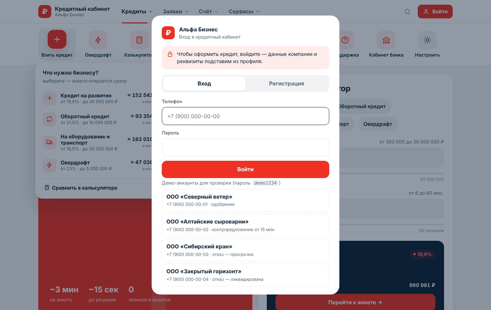 | 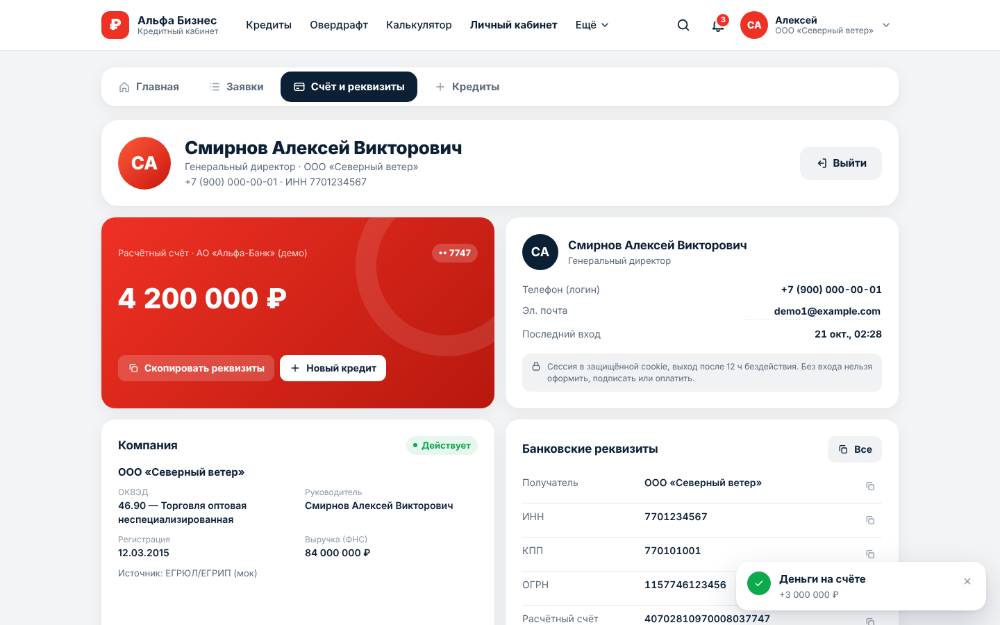 |
| 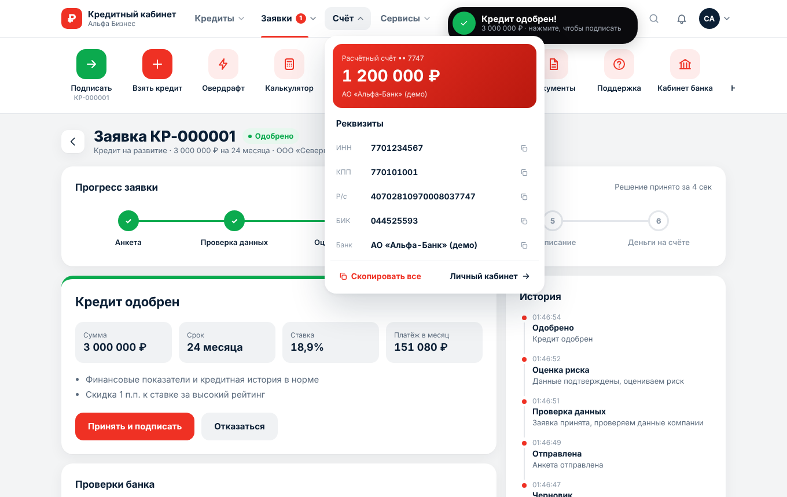 | 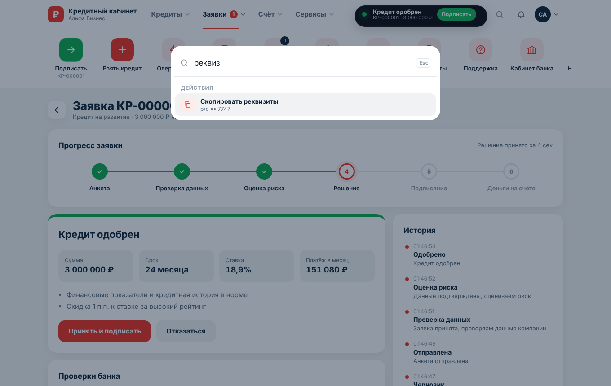 |
| 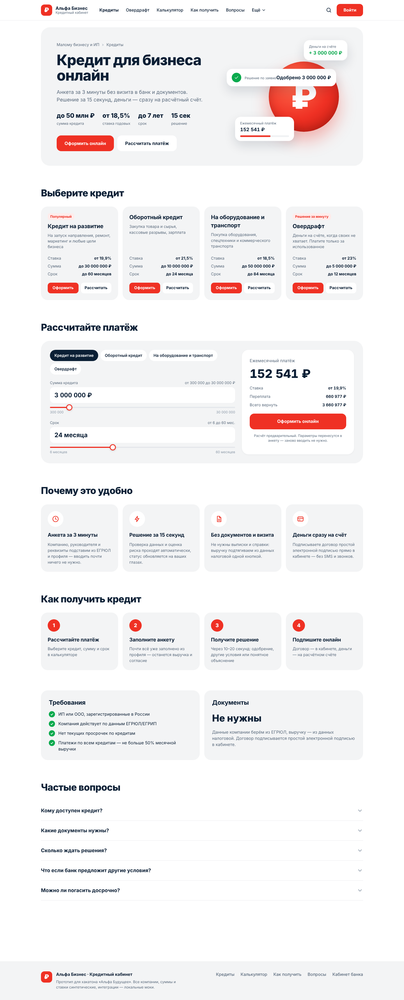 | 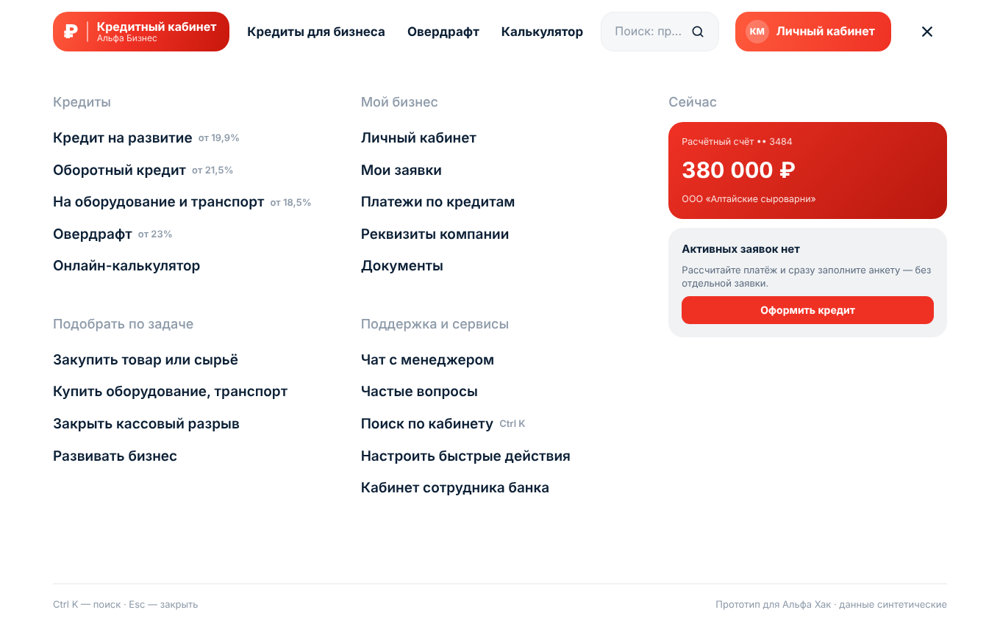 |
| 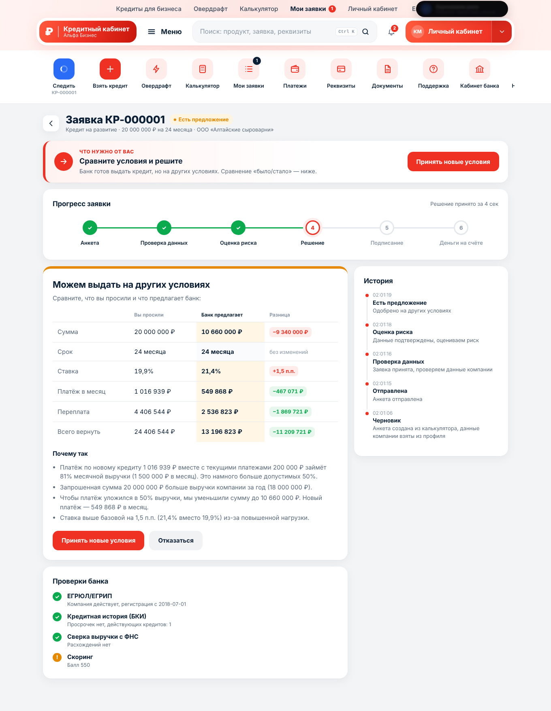 | 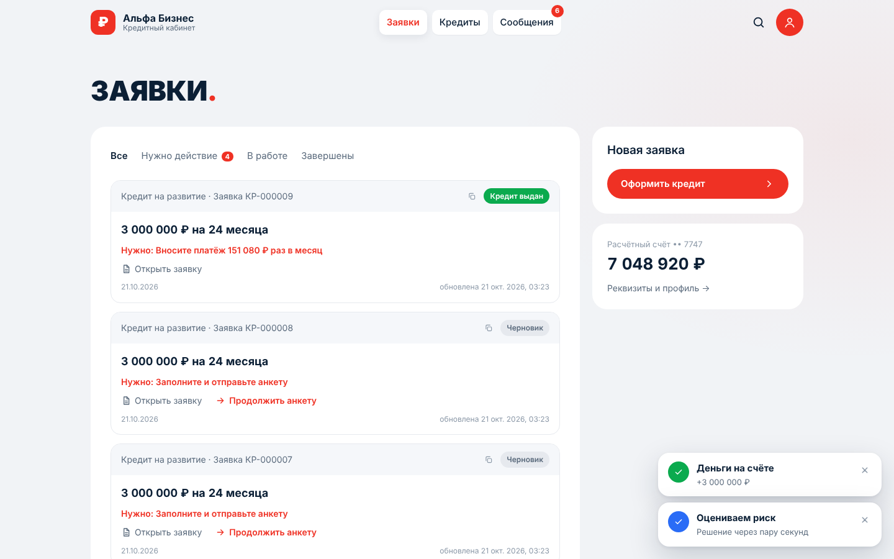 |
| 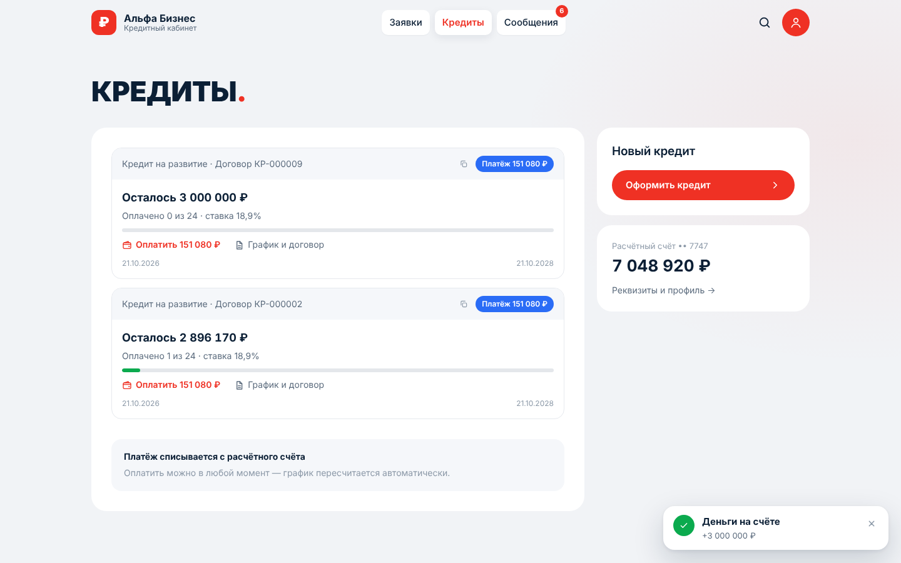 | 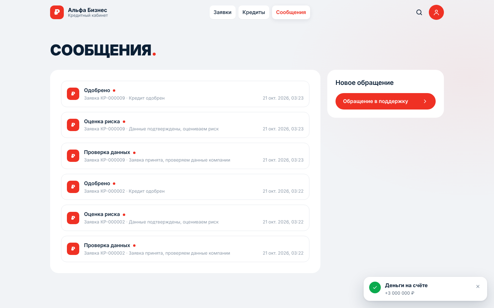 |
| 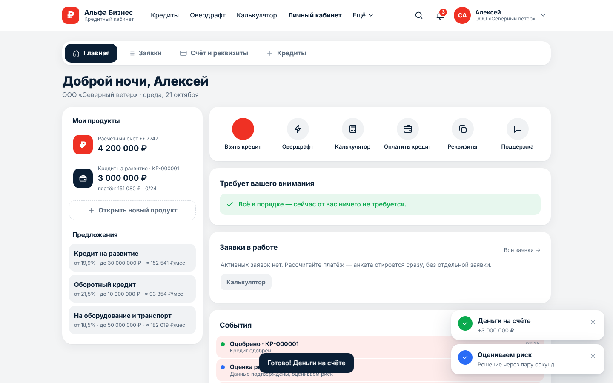 | 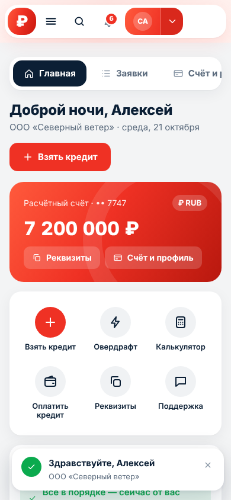 |
