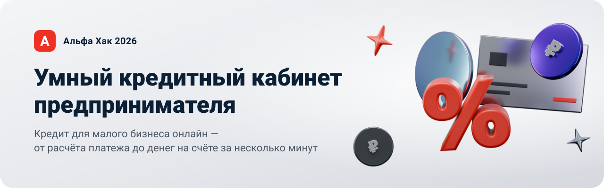
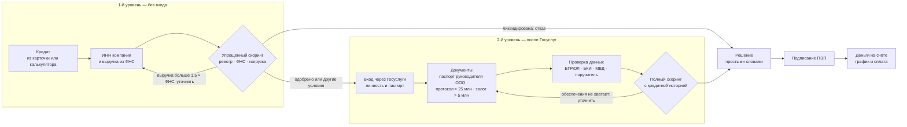
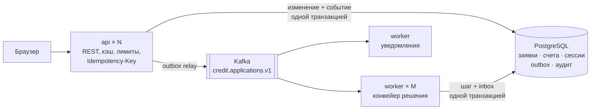
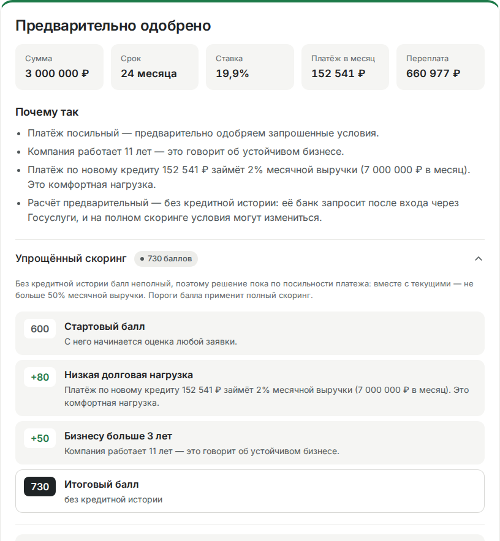
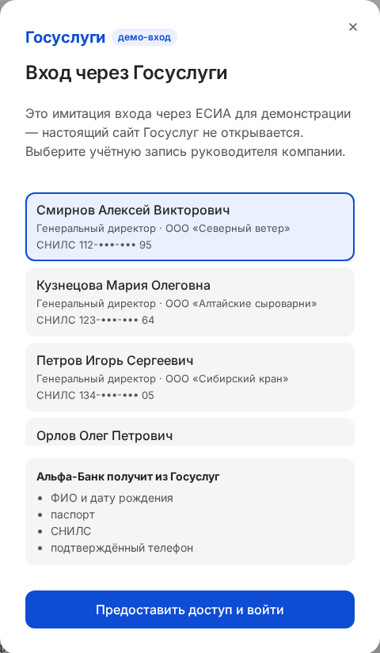
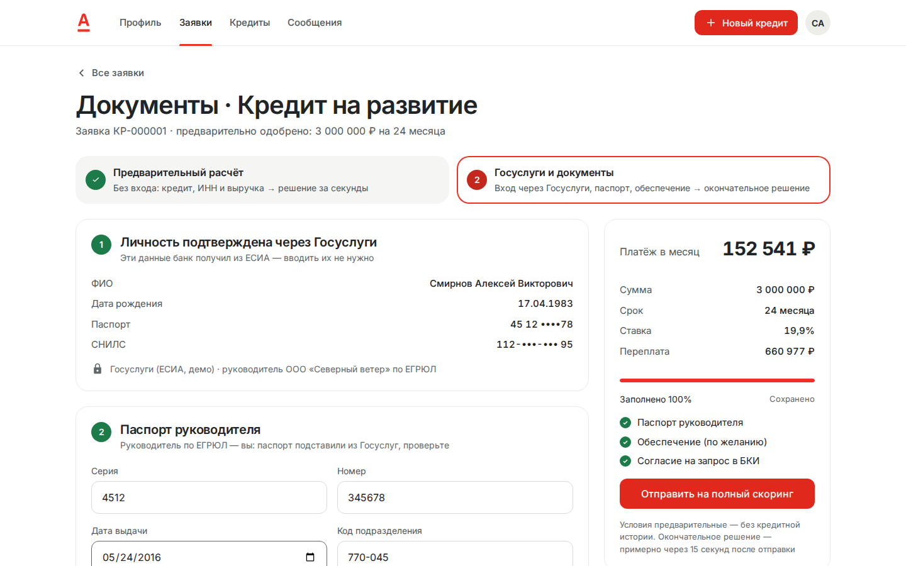
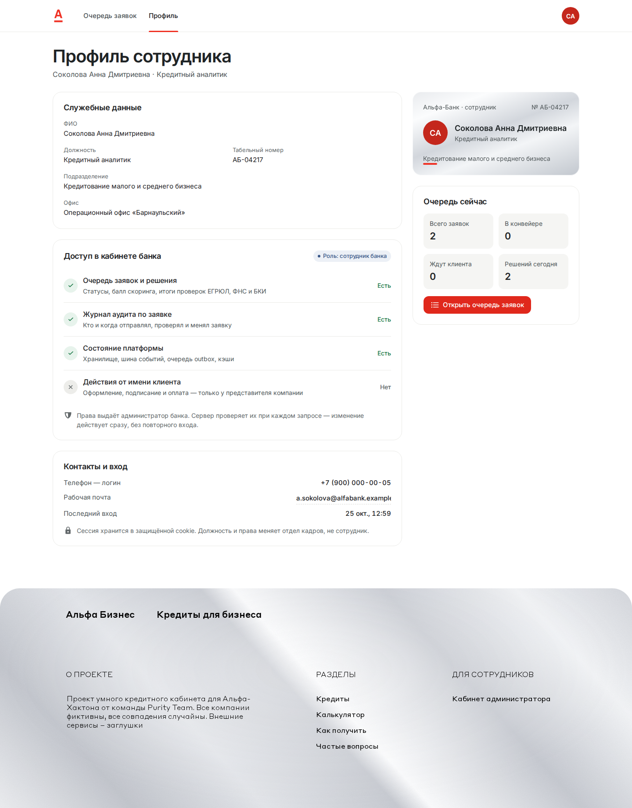
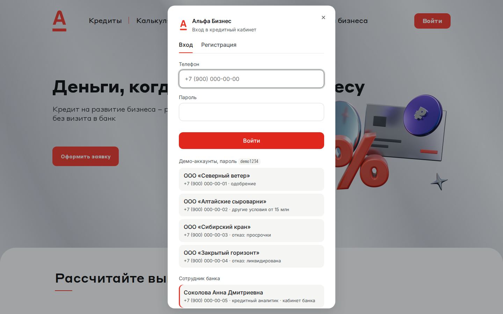

<p align="center">
  
</p>

<p align="center">
  <a href="https://github.com/xdtqwd/alfa-credit/actions/workflows/ci.yml"></a>
  
  
  
  
</p>

<p align="center">
  <b>Клиент</b> подаёт заявку за пару минут · <b>банковский конвейер</b> проверяет данные и решает · <b>обе стороны</b> видят процесс вживую
</p>

<p align="center">
  <a href="#-быстрый-старт"><b>Быстрый старт</b></a> ·
  <a href="#-возможности"><b>Возможности</b></a> ·
  <a href="#-путь-заявки"><b>Путь заявки</b></a> ·
  <a href="#-платформа"><b>Платформа</b></a> ·
  <a href="#-скриншоты"><b>Скриншоты</b></a> ·
  <a href="#-проверка-и-тесты"><b>Тесты</b></a> ·
  <a href="docs/ARCHITECTURE.md"><b>Архитектура</b></a> ·
  <a href="docs/openapi.yaml"><b>API</b></a>
</p>

<br>

<p align="center">
  
  <br>
  <sub>GIF ускорен вдвое · ▶ полное видео с подписями, ~90 с: <a href="demo/alfa-credit-demo.mp4">demo/alfa-credit-demo.mp4</a></sub>
  <br>
  <sub>калькулятор → предварительный расчёт без входа → вход через Госуслуги → документы и залог → кабинет банка → окончательное решение → подписание → деньги → платёж → отказ другому клиенту на полном скоринге</sub>
</p>

<br>

## 🚀 Быстрый старт

> [!TIP]
> Нужен только **Docker** — Desktop или Engine 24+ с Compose v2. Интернет нужен лишь для первой сборки, дальше всё работает офлайн.

```bash
git clone https://github.com/xdtqwd/alfa-credit.git && cd alfa-credit
docker compose up -d --build   # API, worker, PostgreSQL и Kafka; первый запуск — 1–2 минуты
```

Откройте **http://localhost:8080** и нажмите «Оформить заявку» — входить не нужно. На 1-м уровне выберите кредит и компанию из демо-списка ИНН, подставьте выручку из ФНС и получите предварительный расчёт. Дальше — «Войти через Госуслуги»: в демо это окно с учётными записями руководителей демо-компаний, пароль не нужен.

| ИНН в демо-списке | Компания | Что покажет |
|---|---|---|
| `7701234567` | ООО «Северный ветер» | ✅ одобрение; больше 5 млн — нужен залог, больше 25 млн — ещё и протокол |
| `2224000012` | ООО «Алтайские сыроварни» | 🔄 контрпредложение уже на 1-м уровне (20 млн) или уточнение выручки (50 млн) |
| `5401000009` | ООО «Сибирский кран» | ❌ расчёт одобряет, а полный скоринг отказывает: просрочки в БКИ |
| `6600000000` | ООО «Закрытый горизонт» | ❌ отказ сразу: компания ликвидирована |
| `222400000012` | ИП Иванов Иван Иванович | бизнесу меньше года; ИП — без паспорта руководителя и протокола |

Кабинет компании и кабинет банка открываются и обычным входом по телефону — в окне входа, пароль у всех `demo1234`:

| Телефон | Кто | Что покажет |
|---|---|---|
| <code>+7&nbsp;900&nbsp;000‑00‑01</code> | ООО «Северный ветер» | ✅ одобрение → подписание → деньги → оплата |
| <code>+7&nbsp;900&nbsp;000‑00‑02</code> | ООО «Алтайские сыроварни» | 🔄 контрпредложение (от 15 млн) или уточнение (выручка 50 млн) |
| <code>+7&nbsp;900&nbsp;000‑00‑03</code> | ООО «Сибирский кран» | ❌ отказ: просрочки в БКИ |
| <code>+7&nbsp;900&nbsp;000‑00‑04</code> | ООО «Закрытый горизонт» | ❌ отказ: компания ликвидирована |
| <code>+7&nbsp;900&nbsp;000‑00‑05</code> | Сотрудник банка | 🏦 очередь заявок вживую и профиль с правами |

Можно и зарегистрироваться с любым 10- или 12-значным ИНН — компания подтянется из реестра; подать заявку всё равно поможет только вход через Госуслуги.

<details>
<summary><b>⚙️ Без Docker, Makefile и переменные окружения</b></summary>
<br>

С Go 1.24+ без БД и Kafka: `make run` — тот же код на JSON-файлах и шине событий в памяти. Docker: `make up`, `make down`, `make logs`. Kafka UI: `docker compose --profile tools up -d` → http://localhost:8081.

| Переменная | По умолчанию | Назначение |
|---|---|---|
| `APP_MODE` | `production` (в compose и `make run` — `demo`) | `production`: нужен свой `BANK_TOKEN` (от 16 символов), cookie только по HTTPS, иначе сервис не стартует. `demo`: публичный токен и cookie без `Secure` для `http://localhost` |
| `DATABASE_URL` | в compose задан | PostgreSQL; без него — файловый режим |
| `KAFKA_BROKERS` | в compose `kafka:9092` | брокеры через запятую; без них — шина в памяти |
| `APP_ROLE` | `all` | `api` (HTTP и outbox relay), `worker` (обработчики событий и sweeper) или `all` |
| `HTTP_PORT` / `METRICS_PORT` | `8080` / `9090` | порты на хосте; `/metrics` открыт только на 127.0.0.1 |
| `BANK_TOKEN` | в демо `demo-bank` | служебный токен кабинета банка (`X-Bank-Token`) для интеграций; сотрудники входят своей учётной записью |
| `COOKIE_SECURE` | `true` в production, `false` в демо | флаг `Secure` у cookie сессии |
| `PIPELINE_STEP_DELAY` | `3s` | имитация времени каждого этапа конвейера |
| `RATE_LIMIT_RPS` / `RATE_LIMIT_BURST` | `20` / `60` | лимит запросов к API на IP |
| `REQUEST_TIMEOUT` | `10s` | предел времени запроса |
| `CACHE_REGISTRY_TTL` / `CACHE_BUREAU_TTL` | `1h` / `10m` | кэш ответов ЕГРЮЛ/ФНС и БКИ |
| `LOG_LEVEL` / `LOG_FORMAT` | `info` / `json` | логи (`text` — для отладки) |
| `POSTGRES_PASSWORD` | `credit-local` | пароль БД в compose |

Здоровье: `GET /healthz` (процесс жив), `GET /readyz` (PostgreSQL и Kafka доступны, с причиной отказа). Метрики: `GET :9090/metrics`.
</details>

## ✨ Возможности

<table>
  <tr>
    <td width="50%" valign="top">
      <h3>🧮 Расчёт без входа</h3>
      «Оформить» сразу открывает 1-й уровень: кредит из карточки или калькулятора сохраняется. ИНН, выручка из ФНС одной кнопкой — и предварительное решение за доли секунды.
    </td>
    <td width="50%" valign="top">
      <h3>🪪 Вход через Госуслуги</h3>
      2-й уровень начинается с ЕСИА (в демо — имитация): личность и паспорт руководителя подставляются сами. Протокол — только для ООО больше 25 млн ₽, залог — больше 5 млн ₽.
    </td>
  </tr>
  <tr>
    <td valign="top">
      <h3>📍 Прогресс вживую</h3>
      Предварительный расчёт → Госуслуги и документы → проверка данных → полный скоринг → решение → деньги. У каждого шага крупно написано, нужно ли что-то от клиента.
    </td>
    <td valign="top">
      <h3>💬 Решение с объяснением</h3>
      Одобрение, контрпредложение, уточнение или отказ — всегда с причинами на цифрах из анкеты, советом и разбором балла.
    </td>
  </tr>
  <tr>
    <td valign="top">
      <h3>🏦 Кабинет сотрудника банка</h3>
      Очередь заявок конвейера вживую: балл, проверки, решение и состояние платформы. Клиенту этот кабинет закрыт.
    </td>
    <td valign="top">
      <h3>💾 Честное автосохранение</h3>
      «Сохраняем… / Сохранено / Не сохранено · Повторить». Без сети поля не теряются и досохраняются сами.
    </td>
  </tr>
  <tr>
    <td valign="top">
      <h3>🎨 Брендбук Альфа-Банка</h3>
      Главная свёрстана по макету Figma: Styrene A Web, платиновый фон, 3D-иллюстрации. Кабинет — в палитре брендбука, адаптив до телефона.
    </td>
    <td valign="top">
      <h3>🔒 Безопасность</h3>
      Без входа — только расчёт: подать заявку, подписать и оплатить нельзя. HttpOnly-cookie <code>SameSite=Strict</code>, проверка Origin, PBKDF2, защита от перебора, лимиты.
    </td>
  </tr>
</table>

## 🔁 Путь заявки



**Анкета в два уровня.** На **1-м уровне** — без входа и без заявки — клиент выбирает кредит, компанию по ИНН и указывает выручку и текущие платежи. Упрощённый скоринг (реестр, сверка выручки с ФНС, долговая нагрузка) сразу даёт **предварительное** решение. Кредитную историю без согласия идентифицированного заявителя не запрашиваем, поэтому балл тут неполный, а решение — по посильности платежа.

**2-й уровень** начинается со входа через Госуслуги: тогда создаётся заявка, а личность и паспорт руководителя приходят из ЕСИА. Клиент прикладывает документы, и полный скоринг с кредитной историей даёт **окончательное** решение:

- **ООО** — паспорт руководителя; если в анкете руководитель сам, паспорт уже подставлен из Госуслуг;
- **ООО и больше 25 млн ₽** — протокол или решение участников об одобрении крупной сделки;
- **больше 5 млн ₽** — залог хотя бы на половину суммы (с дисконтом: недвижимость 70 %, транспорт 60 %, оборудование 50 %, депозит 95 %) или поручитель без просрочек в БКИ; не хватает — «нужно уточнение» с причиной;
- **залог на всю сумму** — ставка ещё на 1 п.п. ниже.

<details>
<summary><b>🎯 Какие данные дают какой исход</b></summary>
<br>

| Исход | Уровень | Сценарий | Компания | Данные |
|---|:---:|---|---|---|
| ✅ Одобрение (ставка −1 п.п.) | 2 | здоровый бизнес, хорошая кредитная история | «Северный ветер» | 3 млн ₽ на 24 мес., выручка 84 млн ₽ |
| ✅ Одобрение | 2 | крупный кредит на оборудование под залог | «Северный ветер» | 15 млн ₽ на 60 мес., залог 25 млн ₽ |
| ✅ Одобрение | 2 | тот же клиент, что ниже, но разумная сумма | «Алтайские сыроварни» | 3 млн ₽, выручка 18 млн ₽ |
| 🔄 Другие условия | 1 | нагрузка больше 50 % выручки — банк уменьшает сумму | «Алтайские сыроварни» | 20 млн ₽, текущие платежи 200 тыс. ₽/мес. |
| ✍️ Уточнение | 1 | выручка в анкете больше данных ФНС в 1,5+ раза | «Алтайские сыроварни» | выручка 50 млн ₽ |
| ❌ Отказ | 2 | просрочки до 45 дней, 4 кредита — видно только в БКИ | «Сибирский кран» | 3 млн ₽ |
| ❌ Отказ | 1 | компания ликвидирована по ЕГРЮЛ | «Закрытый горизонт» | любая сумма |
| ✍️ Уточнение | 2 | 8 млн ₽, поручитель с просрочками в БКИ | «Северный ветер» | ИНН поручителя `540100000009` |
| ✅ Ставка ещё −1 п.п. | 2 | 8 млн ₽, залог-недвижимость на всю сумму | «Северный ветер» | залог 15 млн ₽ |

Каждая строка — эталонный случай в тесте `TestScenariosProduceExpectedOutcome`: он проходит предварительный расчёт и, если тот пускает дальше, — заявку с документами через настоящий конвейер. Поэтому таблица не расходится с поведением.
</details>

## 🧱 Платформа

Кредитный процесс меняет деньги и юридически значимые статусы, поэтому платформа устроена как в банке:



| | |
|---|---|
| 🐘 **PostgreSQL** | Выдача и платёж атомарны (`SELECT … FOR UPDATE`, `CHECK (balance >= 0)`). Журнал аудита неизменяем: триггер запрещает UPDATE и DELETE. Сессии и ключи идемпотентности в БД — API масштабируется горизонтально. |
| 📨 **Kafka + outbox** | Событие пишется в той же транзакции, что и смена статуса, relay доставляет его в Kafka. Событие не теряется, даже если брокер недоступен, а API продолжает принимать заявки. At-least-once с inbox против дублей, DLQ для «ядовитых» сообщений. |
| ⚡ **Кэш** | ЕГРЮЛ/ФНС (1 ч), БКИ (10 мин), калькулятор, сессии; singleflight против шторма запросов; `ETag`/304 для опроса статуса. |
| 🛡 **Надёжность API** | `Idempotency-Key` (повтор не задвоит платёж), лимит `429 + Retry-After`, таймауты, JSON-ошибки с `request_id`, пагинация, gzip. |
| 📊 **Наблюдаемость** | JSON-логи с `request_id` и маскированием персональных данных, метрики Prometheus, `/readyz` с причиной отказа. |

Отказы, гарантии доставки, диаграммы статусов и ER-модель — в **[docs/ARCHITECTURE.md](docs/ARCHITECTURE.md)**.

## 📸 Скриншоты

<table>
  <tr>
    <td align="center"><b>Главная</b><br></td>
    <td align="center"><b>Предварительный расчёт без входа</b><br></td>
  </tr>
  <tr>
    <td align="center"><b>Прогресс заявки</b><br></td>
    <td align="center"><b>Кабинет сотрудника банка</b><br></td>
  </tr>
  <tr>
    <td align="center"><b>Окончательное решение</b><br></td>
    <td align="center"><b>Отказ с объяснением</b><br></td>
  </tr>
</table>

<details>
<summary><b>🖼 Ещё скриншоты</b></summary>
<br>

<table>
  <tr>
    <td align="center"><b>Предварительное решение</b><br></td>
    <td align="center"><b>Вход через Госуслуги (демо)</b><br></td>
  </tr>
  <tr>
    <td align="center"><b>Документы 2-го уровня</b><br></td>
    <td align="center"><b>Контрпредложение уже на 1-м уровне</b><br></td>
  </tr>
  <tr>
    <td align="center"><b>Как банк оценил заявку</b><br></td>
    <td align="center"><b>Кабинет: кредиты</b><br></td>
  </tr>
  <tr>
    <td align="center"><b>Кабинет банка: платформа</b><br></td>
    <td align="center"><b>Профиль сотрудника банка</b><br></td>
  </tr>
  <tr>
    <td align="center"><b>Профиль и реквизиты</b><br></td>
    <td align="center"><b>Меню профиля</b><br></td>
  </tr>
  <tr>
    <td align="center"><b>Вход по телефону: демо-аккаунты</b><br></td>
    <td></td>
  </tr>
</table>

<p align="center">
  
  &nbsp;&nbsp;
  
</p>
</details>

## 🧪 Проверка и тесты

После `docker compose up -d --build` одна команда проходит весь кредитный процесс через API — предварительный расчёт без входа, вход через Госуслуги, заявку с документами, полный скоринг через Kafka, подписание, выдачу, оплату без двойного списания и журнал аудита:

```bash
bash scripts/check.sh           # около 10 секунд
bash scripts/check.sh --chaos   # плюс остановка Kafka: заявки принимаются и после восстановления доходят до решения
```

Самопроверка `/selfcheck` уже лежит в образе — Go, Node и curl на машине не нужны.

```bash
bash scripts/test-all.sh                  # vet, тесты с race-детектором и покрытием, e2e в браузере
cd backend && go test ./...               # только Go, без внешних зависимостей
make test-integration                     # интеграционные тесты на PostgreSQL и Kafka из docker compose
cd tests/lint && npm ci && npm run lint   # фронтенд: ESLint, Prettier, CSS-переменные, юнит-тесты
```

Каждый pull request проходит то же самое в [CI](.github/workflows/ci.yml): тесты на настоящих PostgreSQL и Kafka, весь стек в docker compose, браузерные e2e, самопроверку и отказ Kafka. Правила веток и коммитов — в [CONTRIBUTING.md](CONTRIBUTING.md).

<details>
<summary><b>🔬 Что покрыто тестами</b></summary>
<br>

| Уровень | Что проверяется | Где |
|---|---|---|
| Домен | переходы статусов, валидация анкеты, свойства графика платежей на сотнях комбинаций | `internal/domain` |
| Скоринг и конвейер | упрощённый скоринг без БКИ и полный с ней; одобрение, контрпредложение, уточнение, отказ; паспорт, протокол, обеспечение; сбой внешних сервисов повторяется, а не отклоняет заявку | `internal/scoring`, `internal/pipeline` |
| Сервис | ограничения продукта, чужие заявки невидимы, выдача, оплата, вход при сбое хранилища | `internal/service` |
| PostgreSQL | миграции, outbox в той же транзакции, параллельные оплаты без двойного списания, неизменяемый аудит, сессии и Idempotency-Key | `internal/storage/pgstore` |
| Kafka | порядок внутри ключа, fan-out на две consumer group, «ядовитое» сообщение уходит в DLQ | `internal/events/kafkabus` |
| API | Idempotency-Key, ETag/304, пагинация, лимиты, CSRF, роли, заголовки безопасности, `/readyz` | `internal/httpapi` |
| E2E | 32 сценария в браузере: путь клиента через оба уровня до оплаты, вход через Госуслуги, протокол для крупной сделки, все исходы решения, кабинет банка, телефон, клавиатура, автосохранение без сети. Прогоняются на файлах, PostgreSQL и PostgreSQL + Kafka | `tests/e2e` |

E2E без Node — в образе Playwright (сервер запущен на 8080):

```bash
docker run --rm --network host -v "$PWD":/w -w /w mcr.microsoft.com/playwright:v1.56.0-noble \
  sh -c "cd tests/e2e && npm ci >/dev/null && BASE_URL=http://localhost:8080 node e2e.mjs"
```

С `demo.mjs` вместо `e2e.mjs` тот же запуск записывает демо-видео, с `screens.mjs` — скриншоты. На macOS и Windows замените `localhost` на `host.docker.internal` и уберите `--network host`.
</details>

## 🗂 Структура

Модульный монолит на **Go 1.24** (stdlib, `lib/pq`, `franz-go`) с двумя ролями из одного образа — **api** и **worker**. Фронтенд — SPA на чистом JS без сборки, встроен в бинарь; контейнер — distroless без root.

```
backend/
├── cmd/api/                точка входа, конфиг, graceful shutdown
├── cmd/selfcheck/          сквозная самопроверка запущенного стека
├── internal/domain/        заявка, статусы, продукты, расчёт платежа и графика
├── internal/service/       сценарии клиента и банка: транзакции, аудит
├── internal/pipeline/      конвейер решения: обработчик событий Kafka и sweeper
├── internal/scoring/       балльная модель и кредитная логика
├── internal/notify/        уведомления клиента
├── internal/events/        события и шина; kafkabus/ — Kafka (продюсер, consumer groups, DLQ)
├── internal/storage/       хранение в файлах; pgstore/ — PostgreSQL (миграции, outbox, inbox, аудит)
├── internal/cache/         TTL-LRU кэш с singleflight
├── internal/integrations/  моки ЕГРЮЛ/ФНС, БКИ и Госуслуг (ЕСИА) с кэширующими адаптерами
├── internal/httpapi/       REST /api/v1 и middleware
└── web/static/             фронтенд: css/, js/core, js/pages, js/features, js/ui, fonts/
tests/                      e2e в браузере, линтеры и юнит-тесты фронтенда
docs/                       архитектура, OpenAPI, примеры запросов
```

Контракт API — [docs/openapi.yaml](docs/openapi.yaml), примеры запросов — [docs/requests.http](docs/requests.http).

<details>
<summary><b>📋 Соответствие условиям кейса</b></summary>
<br>

| Требование | Как выполнено |
|---|---|
| Связанный процесс клиент ↔ банк | Клиент подаёт заявку и получает результат; фоновый конвейер проверяет данные через ЕГРЮЛ/ФНС/БКИ, считает балл и принимает решение. Банк видит то же в своём кабинете. |
| Enterprise-ориентированность | Безопасность: обязательный вход, HttpOnly-cookie, CSRF, PBKDF2, CSP, distroless nonroot, маскирование персональных данных, неизменяемый аудит. Надёжность: ACID-транзакции для денег, transactional outbox, идемпотентность. Отказоустойчивость: API работает без Kafka, повторы и DLQ, `/readyz`, graceful shutdown. Масштабирование: stateless API, воркеры по партициям (`--scale worker=N`). Сопровождение: логи, метрики, миграции, OpenAPI. |
| Целостность решения | Один процесс от калькулятора до платежей; каждый шаг виден клиенту и банку, каждое изменение — событие в Kafka и запись в аудите. |
| Контракты внешних сервисов | ЕГРЮЛ/ФНС и БКИ — адаптеры за интерфейсами `Registry` и `CreditBureau`; замена мока на реальный клиент не трогает бизнес-логику. |
| Без платных API | Внешних платных вызовов нет: ЕГРЮЛ, ФНС, БКИ — локальные моки, подписание и выдача симулируются. Работает офлайн. |
| Обычный ПК | Около 1 ГБ RAM на всё, из них Kafka — 512 МБ. ML и GPU не нужны: решение принимает детерминированная балльная модель. |
| Демонстрация | Готовые аккаунты клиента и банка и [видео](demo/alfa-credit-demo.mp4). |
| Репозиторий | Docker, `go.mod`, README, [THIRD_PARTY_NOTICES](THIRD_PARTY_NOTICES), [OpenAPI](docs/openapi.yaml), [архитектура](docs/ARCHITECTURE.md), тесты. |

**Ресурсы:** Windows 10+, macOS 12+ или Linux; Docker Engine 24+ с Compose v2; 2 ядра, 2 ГБ свободной памяти, около 2 ГБ на диске под образы. Итоговый образ сервиса — около 12 МБ.
</details>

## 📌 Допущения MVP

> [!NOTE]
> - Вход через Госуслуги — имитация ЕСИА с демо-людьми (только в `APP_MODE=demo`); вход по телефону и паролю — без SMS. В бою — настоящий OAuth ЕСИА и OIDC (Альфа ID) на API Gateway.
> - Протокол о крупной сделке не загружается на сервер: в демо банк сохраняет только имя и размер файла. Паспорт проверяется в моке МВД.
> - Один брокер Kafka и один экземпляр PostgreSQL, чтобы хватило обычного ПК. В бою — 3 брокера с `min.insync.replicas=2`, PostgreSQL с репликацией, общий кэш и лимиты в Redis.
> - ЕГРЮЛ, ФНС и БКИ — локальные моки с сокращёнными контрактами; подписание и выдача денег симулируются.
> - Все компании фиктивны, все совпадения случайны, данные — выдуманы.

<br>

<p align="center">
  <sub>Сделано для <b>Альфа Хак 2026</b> · кейс «Умный кредитный кабинет предпринимателя»</sub>
</p>
