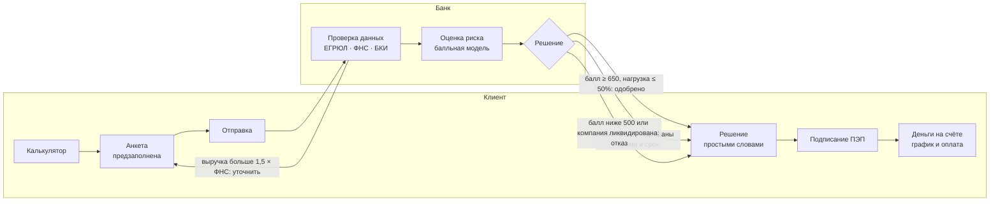
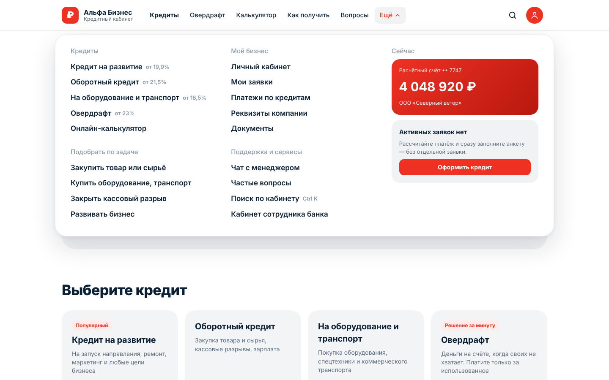

<div align="center">

# Умный кредитный кабинет предпринимателя

**Кредит для малого бизнеса онлайн: от расчёта платежа до денег на счёте — за несколько минут, в одном кабинете.**<br>
Клиент подаёт заявку, банковский конвейер проверяет данные и принимает решение, обе стороны видят процесс в реальном времени.


**Альфа Хак 2026 · кейс «Умный кредитный кабинет предпринимателя»**

[Быстрый старт](#-быстрый-старт) · [Демо](#-демонстрация) · [Как это работает](#-как-это-работает) · [Скриншоты](#-скриншоты) · [Архитектура](docs/ARCHITECTURE.md) · [API](docs/openapi.yaml) · [Тесты](#-тестирование)


<sub>Полное видео с подписями (~75 с): <a href="demo/alfa-credit-demo.mp4">demo/alfa-credit-demo.mp4</a></sub>

</div>

---

## 🚀 Быстрый старт

Нужен только **Docker** (Desktop или Engine 24+ с Compose v2).

```bash
git clone https://github.com/xdtqwd/alfa-credit.git && cd alfa-credit
docker compose up -d --build
```

Откройте **http://localhost:8080** и войдите демо-аккаунтом — в окне входа они выбираются одним кликом.

| Телефон | Пароль | Компания | Что покажет |
|---|---|---|---|
| `+7 900 000-00-01` | `demo1234` | ООО «Северный ветер» | ✅ одобрение → подписание → деньги → оплата |
| `+7 900 000-00-02` | `demo1234` | ООО «Алтайские сыроварни» | 🔄 контрпредложение (сумма от 15 млн) или уточнение (выручка 50 млн) |
| `+7 900 000-00-03` | `demo1234` | ООО «Сибирский кран» | ❌ отказ: просрочки в БКИ |
| `+7 900 000-00-04` | `demo1234` | ООО «Закрытый горизонт» | ❌ отказ: компания ликвидирована |
| Сотрудник банка | — | — | 🏦 все заявки конвейера вживую: «Ещё» → «Кабинет сотрудника банка» или `#/bank` |

Можно и зарегистрироваться с любым 10- или 12-значным ИНН — компания подтянется из реестра.

<details>
<summary><b>Без Docker, переменные окружения, Makefile</b></summary>

С Go 1.24+: `make run` (или `cd backend && go run ./cmd/api`). Docker: `make up`, `make down`, `make logs`.

| Переменная | По умолчанию | Назначение |
|---|---|---|
| `HTTP_PORT` | `8080` | порт на хосте |
| `PIPELINE_STEP_DELAY` | `3s` | имитация времени обработки каждого этапа конвейера |
| `BANK_TOKEN` | `demo-bank` | токен кабинета банка (`X-Bank-Token`) |
| `DATA_FILE` / `USERS_FILE` | `/data/applications.json`, `/data/users.json` | заявки и пользователи (volume `credit-data`) |

Healthcheck: `GET /healthz`, `GET /readyz`. Логи — JSON в stdout с `X-Request-ID`.
</details>

## 🔁 Как это работает



Решение не бинарное: **одобрение**, **контрпредложение**, **запрос уточнения** или **отказ** — всегда с причинами на цифрах из анкеты и советом, что сделать. Сотрудник банка видит ту же заявку в своём кабинете: статус, балл, проверки и решение.

## ✨ Что внутри

| | |
|---|---|
| 🧮 **Калькулятор прямо в анкете** | Платёж пересчитывается на каждое движение ползунка, параметры с главной переносятся в анкету. Считает только сервер (Go) — один источник расчёта для фронта и бэка. |
| ⚡ **Минимум времени** | Без шага «оставить заявку»: кнопка сразу открывает анкету. Компания — из ЕГРЮЛ по ИНН, контакт — из профиля, выручка — из ФНС одной кнопкой. 6 обязательных пунктов, решение за ~7–15 секунд. |
| 📍 **Прогресс заявки** | Шесть этапов (Анкета → Проверка данных → Оценка риска → Решение → Подписание → Деньги), живое обновление, история статусов и результаты проверок. |
| 💬 **Понятные шаги** | У каждого статуса крупно: нужно ли что-то от вас и что именно, с кнопкой действия. При других условиях — таблица «Вы просили / Банк предлагает / Разница» по сумме, сроку, ставке, платежу и переплате. |
| 💾 **Честное автосохранение** | «Сохраняем… / Сохранено / Не сохранено · Повторить». Без сети поля не теряются и досохраняются сами. |
| 🏠 **Минималистичный кабинет** | Заявки · Кредиты · Сообщения, баланс счёта, реквизиты, оплата платежа со своего счёта, уведомления о решениях банка. |
| 🎨 **Стиль Альфа-Банка** | Продуктовая страница как на alfabank.ru, единая шапка, меню «Ещё», меню профиля, поиск `Ctrl K`. Адаптив до телефона. |
| 🔒 **Безопасность** | Без входа нельзя оформить, подписать и оплатить. HttpOnly-cookie `SameSite=Strict`, проверка Origin (CSRF), PBKDF2-хэши паролей, блокировка перебора, лимиты запросов. |

## 🎬 Демонстрация

- **Видео:** [demo/alfa-credit-demo.mp4](demo/alfa-credit-demo.mp4) — весь связанный процесс одним дублем: калькулятор → вход → анкета → заявка идёт по конвейеру в кабинете банка (отправлена → проверка данных → оценка риска → одобрено, балл 790) → решение у клиента → подписание → деньги → оплата → отказ другому клиенту с объяснением.
- **Вживую:** `docker compose up -d --build` и демо-аккаунты выше — роли клиента и сотрудника банка уже готовы.

Видео и скриншоты записываются автоматически с работающего приложения, их легко обновить (Node не нужен):

```bash
docker run --rm --network host -v "$PWD":/w -w /w mcr.microsoft.com/playwright:v1.56.0-noble \
  sh -c "npm i --no-save playwright@1.56.0 >/dev/null && BASE_URL=http://localhost:8080 node tests/e2e/demo.mjs"
# скриншоты: тот же запуск с tests/e2e/screens.mjs (на чистых данных)
```

На macOS/Windows замените `localhost` на `host.docker.internal` и уберите `--network host`.

## 📸 Скриншоты

| Главная | Анкета с калькулятором |
|:---:|:---:|
|  |  |
| **Прогресс заявки** | **Кабинет сотрудника банка** |
|  |  |
| **Одобрено: сравнение условий** | **Контрпредложение** |
|  |  |
| **Отказ с объяснением** | **Кабинет: кредиты** |
|  |  |
| **Меню «Ещё»** | **Меню профиля** |
|  |  |

<p align="center">
  
  &nbsp;&nbsp;
  
</p>

## ✅ Соответствие условиям кейса

| Требование | Как выполнено |
|---|---|
| Связанный процесс клиент ↔ банк | Клиент подаёт заявку и получает результат; фоновый конвейер (`internal/pipeline`) проверяет данные через ЕГРЮЛ/ФНС/БКИ (`internal/integrations`), считает балл и принимает решение (`internal/scoring`). Банк видит то же в «Кабинете сотрудника банка». Кредитная логика упрощённая: балльная модель + долговая нагрузка. |
| Без платных API и подписок | Внешних вызовов нет: ЕГРЮЛ, ФНС, БКИ — локальные моки, подписание и выдача симулируются. Go — только стандартная библиотека, фронтенд — без npm и CDN. Работает офлайн. |
| Обычный ПК | Один контейнер, ~15 МБ памяти. ML-модель и GPU не используются — решение принимает детерминированная балльная модель, поэтому отдельная модель не нужна. |
| Демонстрация | Предзаполненные аккаунты с ролями клиента и банка + [видео](demo/alfa-credit-demo.mp4). |
| Репозиторий | Docker, `go.mod` (внешних модулей нет), README, [THIRD_PARTY_NOTICES](THIRD_PARTY_NOTICES), [OpenAPI](docs/openapi.yaml), [архитектура](docs/ARCHITECTURE.md), тесты. |

<details>
<summary><b>Требования к ресурсам</b></summary>

| | Минимум | Факт |
|---|---|---|
| ОС | Windows 10+, macOS 12+, Linux | — |
| Docker | Desktop / Engine 24+ с Compose v2 | — |
| CPU | 1 ядро | лимит в compose — 0,5 ядра |
| Память | 256 МБ свободной RAM | сервер ~15 МБ, лимит в compose — 128 МБ |
| Диск | ~400 МБ на время сборки, ~10 МБ итоговый образ | бинарь 7 МБ + distroless ~2 МБ |
| Сеть | только для первой сборки (базовые образы) | в работе интернет не нужен |
| GPU / ML-модель | не нужны | скоринг — правила и баллы |
</details>

## 🏗 Архитектура

Модульный монолит на **Go 1.24 (только stdlib)** с фоновым конвейером. Фронтенд (vanilla JS SPA) встроен в бинарь, поэтому всё работает в одном distroless-контейнере без root. Диаграммы компонентов, статусов заявки, ER-модель и sequence — в **[docs/ARCHITECTURE.md](docs/ARCHITECTURE.md)**. Контракт API: [docs/openapi.yaml](docs/openapi.yaml), примеры запросов: [docs/requests.http](docs/requests.http).

```
backend/
  cmd/api/               точка входа, конфиг, graceful shutdown, -healthcheck
  internal/domain/       заявка, статусная машина, продукты, расчёт платежа и графика
  internal/pipeline/     фоновый конвейер: проверка данных → скоринг → решение
  internal/scoring/      балльная модель и кредитная логика
  internal/integrations/ моки ЕГРЮЛ/ЕГРИП/ФНС и БКИ
  internal/service/      сценарии клиента и банка
  internal/storage/      хранилище (MVP — JSON на volume, атомарная запись)
  internal/auth/         пароли (PBKDF2), сессии, защита от перебора
  internal/httpapi/      REST /api/v1, middleware
  web/static/            SPA: index.html, app.css, app.js, nav.js, cabinet.js
tests/e2e/               браузерные тесты, запись демо-видео, скриншоты
```

## 🧪 Тестирование

```bash
./scripts/test-all.sh        # vet → тесты с race-детектором и покрытием → гонки ×20 → e2e в браузере
cd backend && go test ./...  # только Go
```

<details>
<summary><b>Что проверяется</b></summary>

| Уровень | Что проверяется | Где |
|---|---|---|
| Домен | все переходы статусов, валидация анкеты, свойства графика (долг гасится в ноль, сумма графика = итог расчёта) на сотнях комбинаций | `internal/domain` |
| Скоринг | одобрение, контрпредложение, отказ; объяснение опирается на цифры анкеты | `internal/scoring` |
| Конвейер | 5 сценариев решений через моки ЕГРЮЛ/БКИ; отменённая заявка не «оживает» | `internal/pipeline` |
| Сервис | префилл, ограничения продукта, чужие заявки невидимы, выдача, оплата до закрытия | `internal/service` |
| Хранилище | перезапуск, атомарная запись, откат при ошибке, параллельные обновления | `internal/storage` |
| Безопасность API | 401 без входа, 404 на чужие заявки, CSRF → 403, флаги cookie, лимит тела, перебор → 429, токен банка, заголовки | `internal/httpapi` |
| Гонки | параллельные оплаты и подписания: деньги списываются и зачисляются ровно один раз | `internal/httpapi` |
| E2E (браузер) | 17 сценариев: гость, вход по требованию, расчёт с сервера, кабинет, полный путь до оплаты, контрпредложение, уточнение, отказ, автосохранение без сети, шапка без наложений, логотип, меню профиля, меню «Ещё», овердрафт с фиксированным сроком, чужая заявка + регрессии | `tests/e2e/e2e.mjs` |

E2E без Node — в образе Playwright (сервер запущен на 8080, лучше с `PIPELINE_STEP_DELAY=1s`):

```bash
docker run --rm --network host -v "$PWD":/w -w /w mcr.microsoft.com/playwright:v1.56.0-noble \
  sh -c "npm i --no-save playwright@1.56.0 >/dev/null && BASE_URL=http://localhost:8080 node tests/e2e/e2e.mjs"
```

Покрытие Go-кода — около 82%.
</details>

## 📌 Допущения MVP

- Вход по телефону и паролю без SMS (по условиям кейса сценарий не уходит в SMS). В проде — OIDC (Альфа ID) на API Gateway, сессии в Redis.
- ЕГРЮЛ, ФНС, БКИ — локальные моки с сокращёнными контрактами; подписание (ПЭП) и выдача денег симулируются.
- Ставки, лимиты и компании демонстрационные, все данные синтетические.
