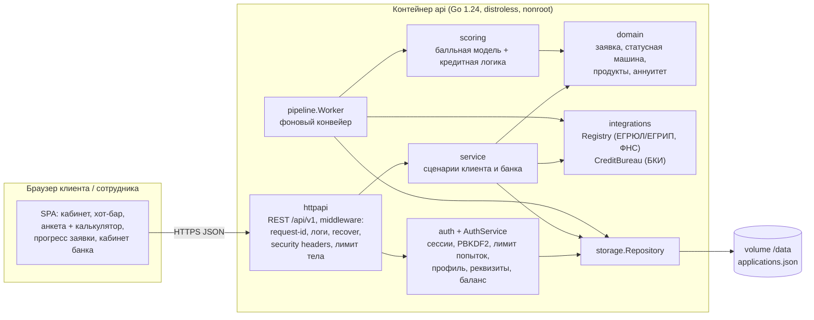
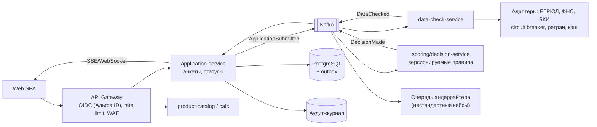
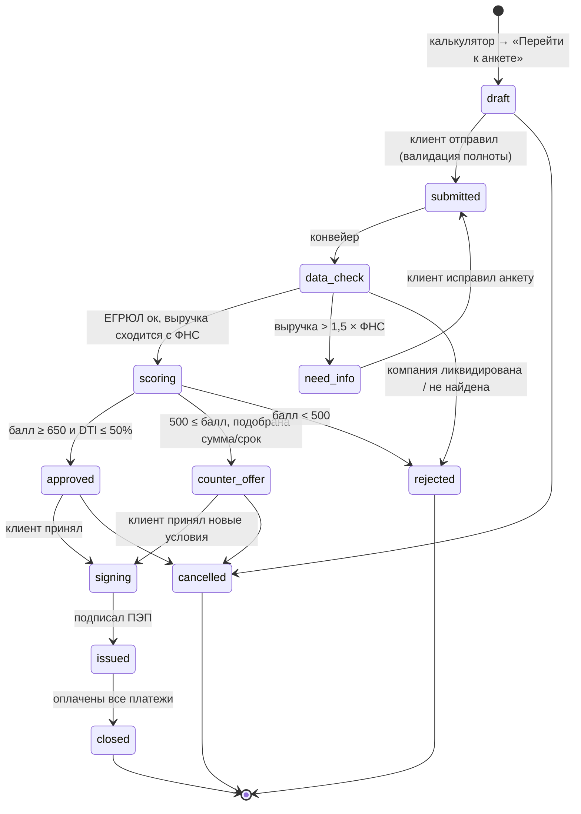
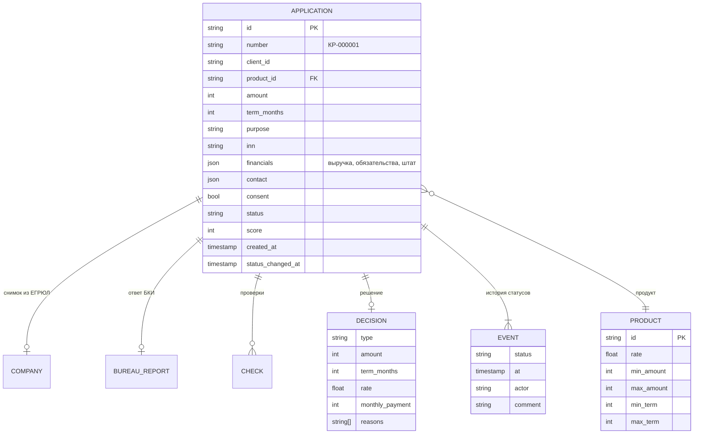
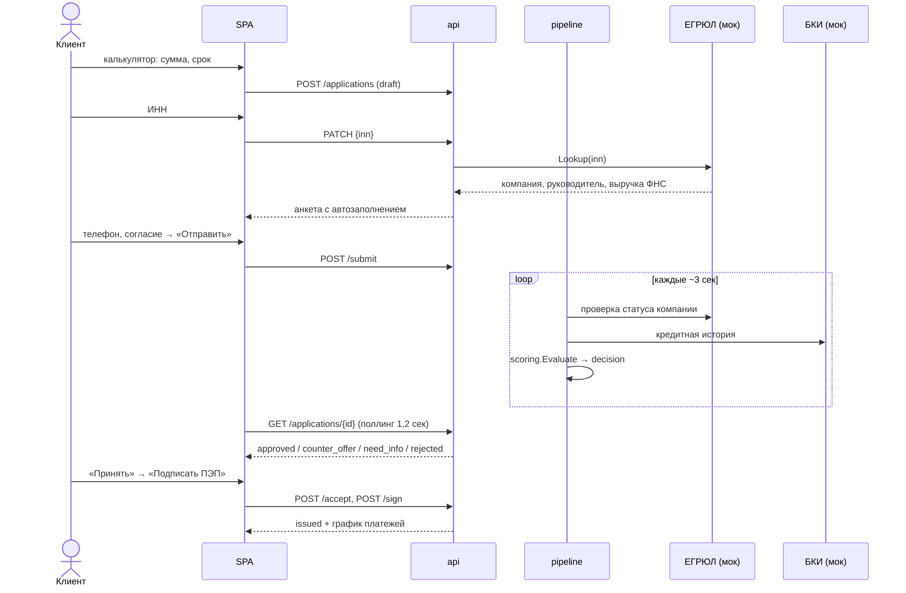

# Архитектура: цифровой кредитный конвейер для МСБ

## 1. Границы MVP

| Входит | Не входит (и почему) |
|---|---|
| Калькулятор → анкета **без промежуточной «заявки»** | Реальные интеграции ЕГРЮЛ/БКИ — по условиям кейса только моки |
| Автозаполнение компании по ИНН (ЕГРЮЛ/ЕГРИП-мок) | Загрузка и распознавание документов — следующий этап |
| Автосохранение анкеты, прогресс заполнения | Реальная ЭП и выдача денег — симуляция ПЭП |
| Конвейер: проверка данных → скоринг → решение | Ручной андеррайтинг (очередь сотрудника) — заложен в статусах, UI read-only |
| 4 типа решения: одобрение / контрпредложение / уточнение / отказ | Мобильное приложение — запрещено условиями |
| Подписание и выдача внутри продукта (без SMS/почты) | |
| Прогресс заявки в реальном времени, кабинет банка | |

**Цель по UX — минимум времени клиента:** 6 обязательных пунктов в анкете, остальное берём из реестров. Параметры кредита переносятся из калькулятора, контактное лицо предзаполняется руководителем из ЕГРЮЛ, выручку можно подставить из данных ФНС одной кнопкой. Решение приходит примерно за 7–15 секунд.

## 2. Компоненты MVP (модульный монолит на Go)

Почему модульный монолит: за время хакатона это один артефакт и один `docker compose up`. При этом границы пакетов совпадают с будущими сервисами (`service`, `pipeline`, `scoring`, `integrations`), зависимости идут только внутрь, к `domain`. Хранилище и интеграции закрыты интерфейсами, поэтому их можно заменить без правки бизнес-логики.

## 3. Целевая архитектура (enterprise)

| Требование | MVP | Цель |
|---|---|---|
| Безопасность | вход обязателен для оформления, подписания и оплаты; сессия в HttpOnly-cookie (SameSite=Strict, TTL 12 ч); проверка Origin против CSRF; пароли PBKDF2-SHA256 с солью; блокировка после 5 неудачных попыток по телефону и IP; nonroot distroless, read-only FS, `cap_drop: ALL`, CSP; чужие заявки отдают 404; лимит тела 64 КБ | OIDC/JWT, mTLS между сервисами, шифрование ПДн (152-ФЗ), Vault |
| Надёжность | атомарная запись (tmp + rename), оптимистичная проверка статуса в worker, graceful shutdown, healthcheck | PostgreSQL + transactional outbox, идемпотентные консьюмеры |
| Отказоустойчивость | ретрай шага конвейера на следующем тике | несколько реплик, circuit breaker на адаптерах, DLQ |
| Масштабирование | stateless HTTP, worker отделён логически | HPA по lag'у Kafka, партиционирование по ID заявки |
| Сопровождение | структурные JSON-логи с request-id, тесты домена и e2e | OpenTelemetry, метрики конверсии по этапам, feature flags на правила скоринга |

## 4. Диаграмма состояний заявки

Каждый переход проверяется в `domain.CanTransition` и пишется в `history` (кто, когда, комментарий). Это аудит-журнал заявки.

## 5. Модель данных

## 6. Скоринг и кредитная логика

Скоринг — это один из элементов конвейера, а не всё решение. Балл считается от базы 600:

| Фактор | Влияние |
|---|---|
| Бизнесу < 1 года / ≥ 3 лет | −80 / +50 |
| Рейтинг БКИ | (рейтинг − 650) / 2, в пределах [−60; +80] |
| Просрочки в БКИ | −150 |
| > 3 действующих кредитов | −40 |
| DTI = (обязательства + новый платёж) / месячная выручка: ≤30% / ≤50% / ≤70% / >70% | +80 / +30 / −40 / −120 |
| Сумма > годовой выручки | −60 |

Решение: балл < 500 → отказ с перечнем факторов. Балл ≥ 650 и DTI ≤ 50% → одобрение (−1 п.п. к ставке при балле ≥ 750). Иначе → **контрпредложение**: максимальная сумма, при которой платёж укладывается в 50% выручки, сначала на запрошенный срок, потом на максимальный срок продукта, ставка +1,5 п.п. Если и так выходит меньше минимума продукта, это отказ.

## 7. Сквозной сценарий

