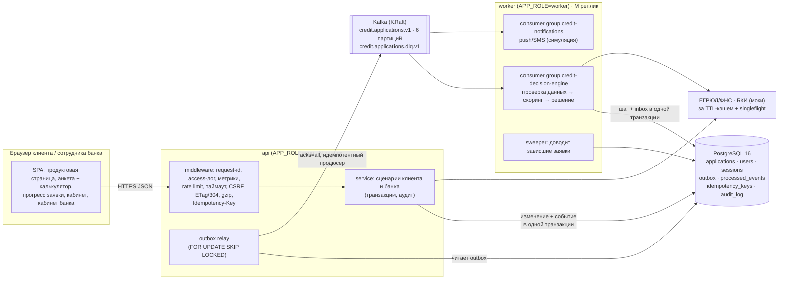
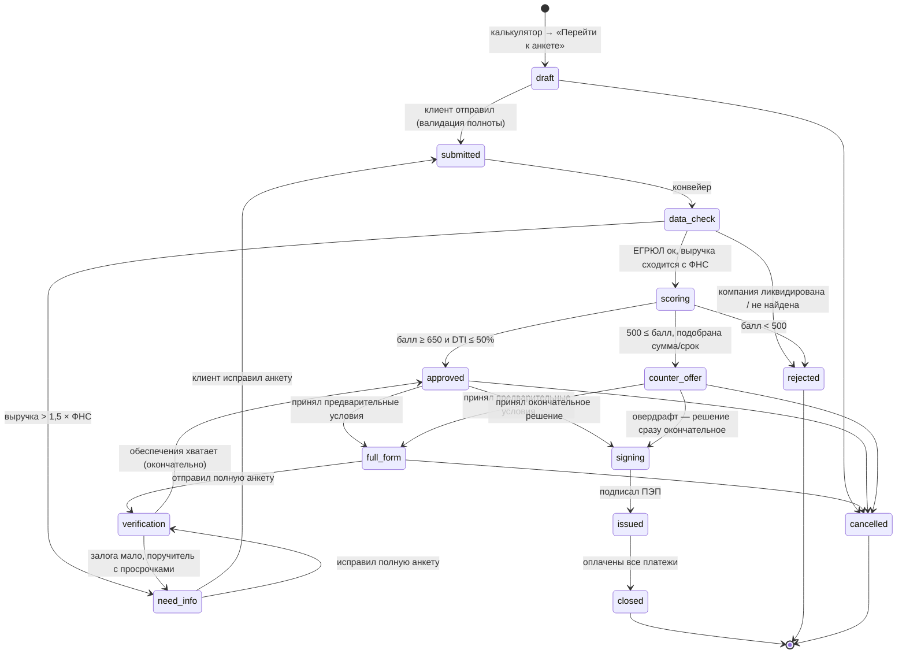
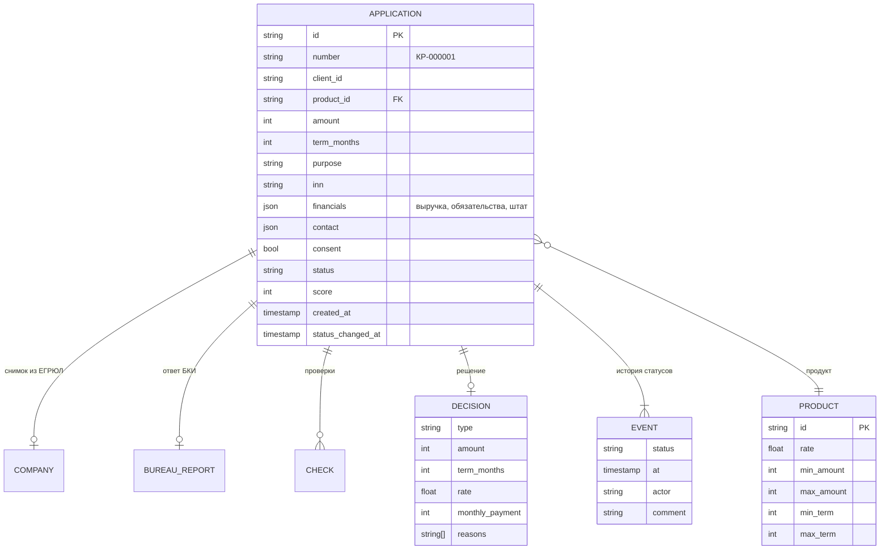
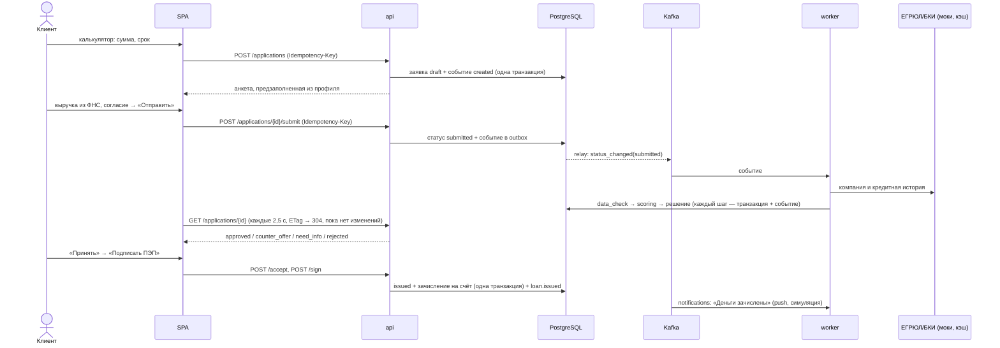

# Архитектура: цифровой кредитный конвейер для МСБ

## 1. Границы MVP

| Входит | Не входит (и почему) |
|---|---|
| Калькулятор → анкета **без промежуточной «заявки»** | Реальные интеграции ЕГРЮЛ/ФНС/БКИ — по условиям кейса контракты упрощены: адаптеры за интерфейсами `Registry` и `CreditBureau` с той же целью (данные компании, выручка, кредитная история), с кэшем и метриками времени ответа; замена мока на реальный клиент не трогает бизнес-логику |
| Автозаполнение компании по ИНН (ЕГРЮЛ/ЕГРИП-мок) | Загрузка и распознавание документов — следующий этап |
| Автосохранение анкеты, прогресс заполнения | Реальная ЭП и выдача денег — симуляция ПЭП |
| Двухуровневая анкета: быстрая → предварительное решение → полная (обеспечение) → окончательное | Оценка залога оценщиком — клиент указывает стоимость, банк применяет дисконт по виду залога |
| Конвейер: проверка данных → скоринг → решение | Ручной андеррайтинг (очередь сотрудника) — заложен в статусах, UI read-only |
| 4 типа решения: одобрение / контрпредложение / уточнение / отказ | Мобильное приложение — запрещено условиями |
| Подписание и выдача внутри продукта (без SMS/почты) | |
| Прогресс заявки в реальном времени, кабинет банка | |

**Цель по UX — минимум времени клиента:** 6 обязательных пунктов в анкете, остальное берём из реестров. Параметры кредита переносятся из калькулятора, контактное лицо предзаполняется руководителем из ЕГРЮЛ, выручку можно подставить из данных ФНС одной кнопкой. Предварительное решение приходит примерно за 7–15 секунд; полная анкета (3–5 минут) нужна, только когда банк уже готов дать деньги.

## 2. Компоненты

Один Go-бинарь (только stdlib + два драйвера), запускается в двух ролях из одного образа:
**api** (HTTP, фронтенд, outbox relay) и **worker** (обработчики событий из Kafka). Роли масштабируются независимо.



Границы пакетов совпадают с будущими сервисами: `service` (application-service), `pipeline` + `scoring` (decision-engine), `notify`, `integrations` (адаптеры). Зависимости направлены внутрь, к `domain`; хранилище, шина, кэш и внешние сервисы закрыты интерфейсами (порты и адаптеры), поэтому тесты идут на in-memory реализациях, а прод — на PostgreSQL и Kafka.

| Пакет | Назначение |
|---|---|
| `domain` | заявка, статусная машина, продукты, расчёт платежа и графика |
| `service` | сценарии: создание, подача, принятие, подписание и выдача, оплата; транзакции и аудит |
| `pipeline` | конвейер решения: consumer + sweeper; идемпотентность через inbox и проверку статуса |
| `scoring` | балльная модель и кредитная логика (раздел 10) |
| `events`, `events/kafkabus` | конверт события, in-memory шина, адаптер Kafka (franz-go) |
| `storage`, `storage/pgstore` | порты хранения; PostgreSQL (lib/pq): миграции, репозитории, outbox, inbox, сессии, аудит |
| `cache`, `idempotency` | TTL-LRU кэш с singleflight; ключи идемпотентности (PostgreSQL / память) |
| `obs` | логгер с корреляцией, маскирование ПДн, метрики Prometheus, аудит |
| `httpapi` | REST `/api/v1`, middleware, раздача фронтенда, `/metrics` |

## 3. Данные: почему PostgreSQL

В кредитном процессе меняются деньги и юридически значимые статусы. Файлы или NoSQL без транзакций здесь не подходят.

| Требование банка | Как закрыто |
|---|---|
| Деньги не теряются и не задваиваются | Выдача (статус `issued` + зачисление на счёт) и платёж (списание + запись платежа) — **одна ACID-транзакция**. Строки блокируются `SELECT … FOR UPDATE` всегда в порядке «заявка → счёт», дедлоков нет. Тест: 8 параллельных оплат кредита на 3 месяца дают ровно 3 платежа, списанная сумма совпадает с записанной. |
| Защита от ошибок в коде | `CHECK (balance >= 0)`: БД не даст уйти в минус, даже если проверка в коде сломается. |
| Аудит | `audit_log` только для добавления: триггер запрещает `UPDATE` и `DELETE`. Пишутся входы (успешные и нет), создание, подача, принятие, подписание и выдача, платежи, отмена. Телефон маскируется. |
| Масштабирование API | Сессии хранятся в БД (только SHA-256 токена), ключи идемпотентности тоже: любой экземпляр API принимает cookie и повтор запроса, выданные другим. |
| Эволюция схемы | Миграции встроены в бинарь, применяются при старте под `pg_advisory_lock`: реплики не мигрируют одновременно. |
| Модель | Агрегат заявки хранится в `jsonb` (анкета, проверки, решение, история меняются вместе с продуктом). Поля для поиска и фильтров (`status`, `client_id`, `inn`, `company_name`, даты) вынесены в колонки с индексами. |

Без `DATABASE_URL` сервис работает на JSON-файлах: режим для тестов и запуска без Docker, бизнес-логика та же.

## 4. События: Kafka + transactional outbox

```mermaid
sequenceDiagram
  participant API as api
  participant PG as PostgreSQL
  participant R as outbox relay
  participant K as Kafka
  participant W as worker (decision-engine)
  API->>PG: BEGIN; UPDATE applications SET status='submitted'; INSERT INTO outbox; COMMIT
  API-->>API: 200 OK клиенту (Kafka не нужна для ответа)
  R->>PG: SELECT … FROM outbox WHERE published_at IS NULL FOR UPDATE SKIP LOCKED
  R->>K: produce (key = id заявки, acks=all)
  R->>PG: UPDATE outbox SET published_at = now()
  K->>W: application.status_changed (to = submitted)
  W->>PG: BEGIN; INSERT processed_events (inbox); шаг конвейера; INSERT outbox (новое событие); COMMIT
  W->>K: commit offset
```

- **Зачем outbox.** Если писать в БД и в Kafka отдельно, то при сбое между ними статус изменится, а событие потеряется (или наоборот). Здесь событие — строка в той же транзакции, что и изменение. Relay доставит его, когда Kafka будет доступна.
- **Топик** `credit.applications.v1`, ключ — id заявки: события одной заявки упорядочены внутри партиции, разные заявки обрабатываются параллельно. 6 партиций — потолок параллелизма consumer group.
- **Типы событий:** `application.created`, `application.status_changed`, `loan.issued`, `loan.payment_received`. Полезная нагрузка без ПДн: идентификаторы, статусы, суммы. В заголовках — `request_id` для сквозной трассировки HTTP → Kafka → воркер.
- **Потребители (fan-out):** `credit-decision-engine` (конвейер) и `credit-notifications` (уведомления) читают один топик независимо. В банке так же подключаются CRM, аналитика и АБС — без изменений в API.
- **Гарантии:** продюсер идемпотентный, `acks=all`; consumer коммитит offset **после** обработки (at-least-once); дубли отсекает inbox (`processed_events`) в той же транзакции, что и действие, плюс проверка ожидаемого статуса; после 5 неудачных попыток сообщение уходит в `credit.applications.dlq.v1` и не блокирует партицию.
- **Без Kafka** (локальный режим) работает in-memory шина с теми же контрактами: партиции по ключу, consumer groups, повторы, DLQ.

### Сценарии отказов

| Что сломалось | Что происходит |
|---|---|
| Kafka недоступна | API продолжает принимать заявки (проверено: подача отвечает 200 за 7 мс при «замороженном» брокере), события копятся в outbox, `/readyz` отвечает `200 degraded` с `kafka: fail` (для API шина некритична — балансировщик не снимает его с трафика; у воркера без Kafka — `503`), метрика `outbox_pending_events` растёт. После восстановления relay дозаливает события, заявки доходят до решения. |
| Воркер упал посреди шага | Offset не закоммичен, транзакция шага откатилась — событие придёт снова (себе же после рестарта или другому экземпляру группы после ребаланса). |
| Повторная доставка | inbox + проверка статуса: шаг не выполнится дважды, уведомление не уйдёт дважды. |
| «Ядовитое» сообщение | 5 попыток с экспоненциальной паузой → DLQ, партиция идёт дальше. |
| Событие потерялось (баг, ручное вмешательство) | sweeper раз в 5 с находит заявки, застрявшие на этапе дольше `StepDelay + 20 с`, и продвигает их сам (метрика `pipeline_swept_total`). |
| PostgreSQL недоступна | `/readyz` → 503: балансировщик снимает трафик, запросы падают по таймауту (10 с), а не висят. |
| Обрыв сети у клиента после «Оплатить» | Фронт повторяет запрос с тем же `Idempotency-Key`, сервер возвращает сохранённый ответ: второго списания нет. |
| Внешний сервис (ЕГРЮЛ/БКИ) медленный | Ответы кэшируются (ЕГРЮЛ — 1 ч, БКИ — 10 мин, «не найдено» — 5 мин); singleflight: на холодный ключ уходит один запрос, остальные ждут его. |

## 5. API: поведение как у банковских API

| Механизм | Где |
|---|---|
| `Idempotency-Key` на `POST /applications` и `…/{submit,accept,sign,pay,cancel}` | повтор → сохранённый ответ + `Idempotent-Replayed: true`; тот же ключ с другим телом → 422; ещё выполняется → 409 + `Retry-After`; ключи привязаны к клиенту, хранятся 24 ч |
| Пагинация и фильтры | `?limit=&offset=&status=a,b&q=` (поиск по номеру, ИНН, компании), заголовки `X-Total-Count` и `Link` (RFC 8288) |
| Условные запросы | `ETag` + `If-None-Match` → `304` без тела: опрос статуса каждые 2,5 с почти не грузит сеть; справочники — `Cache-Control: public, max-age=300`; статика — ETag по содержимому |
| Лимиты | token bucket на IP (по умолчанию 20 rps, запас 60) → `429` + `Retry-After`; отдельная блокировка перебора пароля |
| Таймауты | 10 с на запрос (контекст до БД и интеграций), таймауты чтения/записи сервера, лимит тела 64 КБ |
| Ошибки | единый JSON `{"error":{"code","message","field","request_id"}}`, JSON 404/405 (+ `Allow`) для неизвестных путей API |
| Сжатие | gzip для JSON, JS, CSS, HTML |
| Корреляция | входящий `X-Request-ID` от шлюза принимается (если безопасного вида) или генерируется; он есть в ответе, логах, аудите и событиях Kafka |

## 6. Наблюдаемость и сопровождение

- **Логи** — JSON (`LOG_FORMAT=text` для отладки), уровень из `LOG_LEVEL`. Access-лог: метод, маршрут-шаблон, статус, байты, длительность, IP, клиент, `rid`. 5xx пишутся как error, 4xx — warn, статика и 304 — debug.
- **Метрики** — `/metrics` в формате Prometheus на служебном порту 9090 (наружу не публикуется): `http_requests_total`, `http_request_duration_seconds` по маршрутам, `events_published_total` / `events_consumed_total{result=ok|dlq}`, `outbox_pending_events`, `credit_decisions_total{decision}`, `pipeline_step_seconds`, `pipeline_swept_total`, `cache_requests_total{cache,result}`, `loans_issued_amount_rub_total`, `http_idempotent_replays_total`, `audit_events_total`.
- **Health** — `/healthz` (liveness), `/readyz` (readiness: PostgreSQL + Kafka, с причиной отказа).
- **Кабинет банка** показывает состояние платформы: хранилище, шину, очередь outbox, долю попаданий в кэш.
- **Аудит** — таблица `audit_log` и `GET /api/v1/bank/applications/{id}/audit`.

## 7. Масштабирование и безопасность

| | Как |
|---|---|
| API | stateless (сессии и ключи идемпотентности в БД) → N реплик за балансировщиком; outbox relay в каждой, `SKIP LOCKED` делит работу без пересечений |
| Конвейер | `docker compose up --scale worker=3`: партиции делятся между экземплярами группы (проверено на двух воркерах: работа разделилась, 12/12 заявок решены, дублей нет); потолок — число партиций |
| БД | пул соединений (20), индексы под все запросы списков; в проде — реплика на чтение для кабинета банка |
| Безопасность | вход обязателен для оформления, подписания и оплаты; HttpOnly-cookie `SameSite=Strict`; проверка Origin (CSRF); PBKDF2-SHA256; блокировка перебора; в БД — хэш токена сессии; чужие заявки отдают 404; CSP, `frame-ancestors 'none'`, `X-Frame-Options`, `Permissions-Policy`; distroless nonroot, read-only FS, `cap_drop: ALL`; ПДн не попадают в события и маскируются в логах |
| Целевое (вне MVP) | OIDC (Альфа ID) на API Gateway, mTLS между сервисами, Vault для секретов, шифрование ПДн по 152-ФЗ, Redis для общего кэша и лимитов, OpenTelemetry-трейсинг, Kafka 3 брокера с `min.insync.replicas=2`, Patroni/HA для PostgreSQL |

## 8. Диаграмма состояний заявки



Каждый переход проверяется в `domain.CanTransition`, пишется в `history` заявки (кто, когда, комментарий) и порождает событие `application.status_changed` в outbox.

## 9. Модель данных



## 10. Скоринг и кредитная логика

Скоринг — это один из элементов конвейера, а не всё решение. Балл считается от базы 600:

| Фактор | Влияние |
|---|---|
| Бизнесу < 1 года / ≥ 3 лет | −80 / +50 |
| Рейтинг БКИ | (рейтинг − 650) / 2, в пределах [−60; +80] |
| Просрочки в БКИ | −150 |
| > 3 действующих кредитов | −40 |
| DTI = (обязательства + новый платёж) / месячная выручка: ≤30% / ≤50% / ≤70% / >70% | +80 / +30 / −40 / −120 |
| Сумма > годовой выручки | −60 |

Решение: балл < 500 → отказ с перечнем факторов. Балл ≥ 650 и DTI ≤ 50% → одобрение (−1 п.п. к ставке при балле ≥ 750). Иначе → **контрпредложение**: максимальная сумма, при которой платёж укладывается в 50% выручки, сначала на запрошенный срок, потом на максимальный срок продукта, ставка +1,5 п.п. Если и так выходит меньше минимума продукта, это отказ.

## 11. Сквозной сценарий


